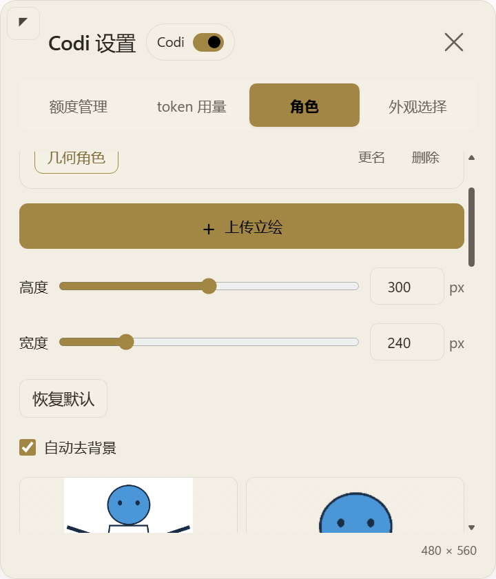
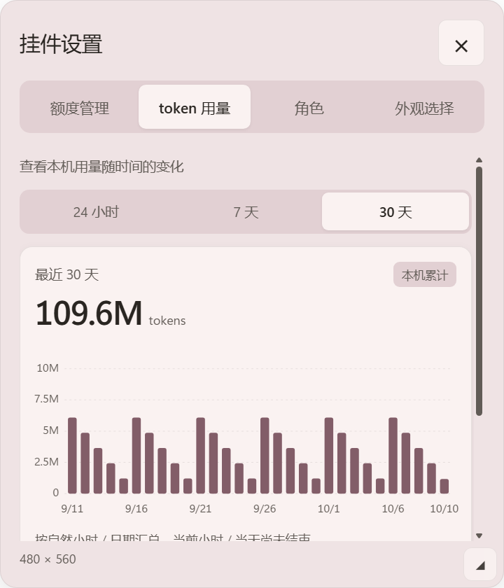
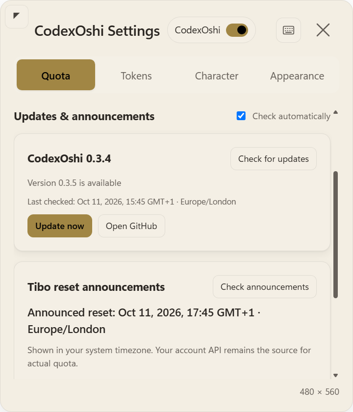

# Codi

<p align="center">
  <a href="README.md">English</a> | <a href="README.zh-CN.md">中文</a>
</p>

你的 Codex 桌面小伙伴：查看额度、统计本机 token 用量、自定义角色与对话。

> 当前支持 **Windows x64 与 Codex 桌面应用**。Codi 只读取额度和本机用量，不生成模型回复。角色图片始终留在本机。

**形象建议**：推荐使用透明背景、全身完整的 **Q 版角色**。比例紧凑，在小挂件中更容易看清。普通立绘也可以使用。

## 功能

- **直观查看额度**：剩余百分比、进度条、重置倒计时，以及账户数据提供的可用重置卡次数。Codi 只展示重置卡，不使用重置卡。
- **按时间查看 token**：24 小时按小时分为 24 柱，7 天和 30 天按每天一柱展示，同时提供所选总量与精确数值。当前小时／当天尚未结束。
- **一张立绘即可使用**：直接上传、切换角色、去除简单背景，并在本机预览中调整取景。旧版多态角色仍可使用。
- **两段点击对话**：点击立绘始终显示第一段重置信息，点击气泡才循环切换两段内容。关闭气泡后从第一段重新开始。可在设置页直接编辑，也可选择预设。
- **立绘尺寸调节**：大小与宽度放在一起，都有滑杆和可输入的数字。取景只保留 0.5–4× 倍数及 −/+ 微调，进度条位于人物下方。
- **跟随窗口**：默认固定在 Codex 右下角，小窗口时等比缩小；关闭固定选项后可拖动，保存手动位置。
- **统一设置卡片**：点击进度条旁的齿轮，查看额度管理、token 用量、角色、外观选择。卡片可调节大小，点击空白处关闭；每次重新打开都回到「额度管理」。
- **配色与语言**：七套双配色、自定义底色和强调色，支持简体中文／English，设置保存在本机。
- **一键更新**：每 6 小时自动检查新版本。发现新版后，在 Codi 设置中点「一键更新」，自动下载、安装并重启 Codi，保留角色与设置。
- **点击音效**：在「Codi 设置 → 角色 → 点击音效」选择木琴轻点、水滴啵啵、清透铃音、星光双音或柔和轻敲。每项可独立试听，试听不切换，点选自动保存。也能上传自己的声音，切换预设后仍可切回；音量可调为 0–100%。支持 WAV / MP3 / OGG / M4A / FLAC，最长 30 秒、最大 10 MiB；文件和选择均保存在本机。
- **Tibo 重置公告**：每 30 分钟读取 @thsottiaux 的免费公开时间线，有明确时间的重置公告按系统时区显示，支持夏令时和跨日换算；新公告提醒一次。
- **可见开关**：在设置卡片内关闭挂件后，Codex 窗口内保留小开关，方便再次开启。

## 效果预览

截图使用几何占位图与合成用量，不包含用户角色素材。





## 运行要求

- Windows x64，系统自带 Windows PowerShell 5.1 与 .NET Framework C# 编译器。
- 已安装并登录 Codex 桌面应用，安装程序可找到其 CLI。
- Node.js 24+：安装 Electron，并运行插件的本机状态接口。24+ 是当前支持并测试的版本范围，尚未验证更早版本。
- Git：仅用于下方的源码下载和更新，挂件运行不需要 Git。
- 安装下载与账户额度读取需要网络，无需另外填写 API Key。

不需要 MSVC、C++ 原生模块或额外 C# SDK。当前实现不支持 macOS、Linux。

如果通过 GitHub 的 **Code → Download ZIP** 下载源码并解压到指定安装目录，可以不安装 Git。当前提供源码安装，还没有免依赖的一键安装包。

## 安装

### 方法一：让 Codex 帮你安装

在 Codex 桌面版新建一个本机聊天，把下面这段话发给它：

```text
请帮我在这台 Windows 电脑上安装 Codi：https://github.com/Chester-chs/Codi。
先检查 Codex、Git 和 Node.js 24+，缺少依赖请协助安装。
把项目放在 %USERPROFILE%\plugins\codex-quota-widget。若目录已存在，先检查，保留我的本地修改、角色和设置。
在项目目录运行：powershell.exe -NoProfile -ExecutionPolicy Bypass -File scripts\install.ps1。
安装后确认 Codi 能在 Codex 中显示，并告诉我如何使用可见开关。如果需要重启 Codex，请提醒我自行重启。
```

### 方法二：自己安装

1. 安装并登录 Codex 桌面版。没有 **Node.js 24+** 和 **Git** 的话，先安装这两个工具。
2. 打开 Windows 开始菜单，搜索 **PowerShell** 并打开，复制运行下面几行：

```powershell
New-Item -ItemType Directory -Force "$env:USERPROFILE\plugins" | Out-Null
git clone https://github.com/Chester-chs/Codi.git "$env:USERPROFILE\plugins\codex-quota-widget"
Set-Location "$env:USERPROFILE\plugins\codex-quota-widget"
powershell.exe -NoProfile -ExecutionPolicy Bypass -File scripts\install.ps1
```

3. 等安装完成后，完全退出并重新打开 Codex，再新建一个聊天。Codi 应出现在右下角。

请使用上面的安装目录，脚本会检查路径。已安装 Codi 0.2.0 或更新版本，可以直接在 Codi 设置里更新；更早版本先用方法一更新一次，不要重复克隆。仓库保持私有时，你的 GitHub 账号需要有下载权限。

安装后默认随 Windows 登录启动。不需要自启，可在安装命令末尾加 `-NoStartup`；加 `-NoStart` 则不立即启动。之后更新 MCP 服务，也需要重新打开 Codex 并新建聊天。

## 更新与重置公告

打开 **Codi 设置 → 额度管理**，向下找到 **更新与公告**。可以手动「检查更新」「检查公告」，也可以用「自动检查」开关控制后台检查。自动检查在 Codi 开启、Codex 窗口可见时进行；系统允许时会显示静默通知，齿轮旁的小圆点也会提示新消息。



- **版本**：点「检查更新」，发现新版后点「一键更新」即可。Codi 会先下载并准备好新版本，再自动重启。准备失败时继续运行当前版本；安装失败时尝试恢复原版。立绘、对话、配色和位置都会保留。私有仓库需要 GitHub CLI 已通过 `gh auth login` 登录有访问权限的账号；公开仓库无需登录。不会重启 Codex；MCP 服务的更新在下次重启 Codex 后生效。
- **更新存储**：新版本和恢复备份保存在本机 Codi 数据目录，源码文件夹保持原样。维护者发布新版时需提高 `package.json` 和 `package-lock.json` 中的应用版本号；插件注册版本单独管理。
- **公告**：来源为 [Tibo @thsottiaux](https://x.com/thsottiaux)，免费、无需 X API 密钥。公开时间线可能限流或失效；失败会保留上次结果，限流至少等待 30 分钟再试。手动检查也有 1 分钟间隔。
- **时间**：读取明确日期／今天／明天／星期、UTC 或美东／太平洋时区，以及「几小时后」等常见表达。模糊、条件式或无法确认的时间不会猜测，会显示原文供查看。公告时间与账户实际额度分开展示，时间到达不会自行认定额度已恢复。
- **提醒**：只提醒近期的新公告，记录已提醒的公告，重启后不重复；公告正文作为文本展示。系统时区变更后会重新换算。

## 在 Codex 中开启与关闭

1. 点击进度条旁的齿轮打开设置。
2. 点击**设置卡片顶部的 Codi 开关**关闭挂件。立绘、进度条、对话和设置卡片隐藏，同时暂停新的额度读取与 token 索引；已经发出的额度请求可能仍会完成。
3. Codex 窗口右下角保留一个**小 Codi 开关**，点击即可重新开启，恢复原尺寸和位置。

开关状态会保存，重启后仍沿用。这是 Codi 在 Codex 窗口内提供的控件，不是在 Codex 原生设置页添加控件。× 只关闭设置卡片；Codex 插件列表的开关单独控制 MCP 服务。


若需停止整个后台监控（包括小开关）或重新启动，可使用 PowerShell：

```powershell
# 启动后台监控；保留已保存的可见开关状态
powershell.exe -NoProfile -ExecutionPolicy Bypass -File "$env:USERPROFILE\plugins\codex-quota-widget\scripts\start.ps1"

# 停止后台监控，保留角色和设置
powershell.exe -NoProfile -ExecutionPolicy Bypass -File "$env:USERPROFILE\plugins\codex-quota-widget\scripts\stop.ps1"
```

停止会保存后台监控的停用状态，再次启动会重新启用。卸载用以下命令：移除登录任务与插件条目，保留用户数据。

```powershell
powershell.exe -NoProfile -ExecutionPolicy Bypass -File "$env:USERPROFILE\plugins\codex-quota-widget\scripts\uninstall.ps1"
```

## 使用方法

1. 打开 Codex，Codi 跟随其客户区；宿主不可用或最小化时隐藏。
2. 点击立绘显示对话，点击齿轮打开设置卡片。
3. 在「角色」中点击「上传立绘」，无需先新建。大小与宽度可直接输入数字，无效值不会替换最后有效设置。
4. 调整取景倍数，并拖动处理后的预览进行平移。倍数控制展示范围，宽度独立控制；调整立绘尺寸时，打开的设置卡片保持稳定。
5. 在同一页编辑两段对话。`{重置时间}` 只替换为时长，例如 `3天21小时`，前后的语句由你填写。预设仍可编辑，保存后生效。
6. 在「外观选择」中选择主题，或自定义底色与强调色。文字与选中态采用调整后的对比色，保持可读。

额度阈值保持不变：大于 20% 为正常色，大于 10% 且不超过 20% 为橙色，不超过 10% 为红色。立绘不随额度变化。

## 数据与隐私

- **不启动模型任务**：额度读取限制为固定额度 HTTP GET、本机 `auth.json` 与 `sessions/**/*.jsonl`，以及 app-server 的 `initialize`／`account/rateLimits/read`。不生成补全、不启动 agent turn，因此不会因挂件读取而消耗模型额度。
- **更新与公告联网**：额外读取固定 GitHub 仓库及 X 公开时间线；点击「一键更新」后下载仓库更新包，依赖变化时下载所需运行环境。不会向这些地址发送 Codex 令牌、对话或立绘。私有仓库通过 GitHub CLI 使用其已有登录，Codi 不读取或保存 GitHub 令牌。
- **图片仅在本机**：按内容校验 PNG、JPEG、WebP、GIF、BMP，单文件最多 10 MiB、单边最多 4096 像素；不支持 HEIC。上传入口只复制本机原图，替换保留此前副本，没有图片上传到网络的入口。
- **旧角色兼容**：明确选择的单张立绘优先；否则按 `ready > tired > low > exhausted` 选择第一张可用图。读取不删除旧图、不改写旧设置。
- **token 统计范围**：汇总本机现存 Codex 会话的 token-count 正增量，非账户官方总量，不含已删除会话和其他电脑的数据。索引中／部分覆盖提示表示统计尚不完整。
- **额度时效**：读取失败保留可用数据，并标出更新年龄或状态。重置时间到达不会自行伪造已恢复额度；重置卡数据不可用时保持未知。
- **本机存储**：数据位于 `<CODEX_HOME>\codex-quota-widget`；未设置 `CODEX_HOME` 时为 `%USERPROFILE%\.codex\codex-quota-widget`。源码、插件缓存和用户数据分离；认证令牌不写入挂件诊断文件。

请只上传你有权使用的素材。仓库内置几何占位图，不分发用户角色图片。

## 验证与技术说明

```powershell
Set-Location "$env:USERPROFILE\plugins\codex-quota-widget"
powershell.exe -NoProfile -ExecutionPolicy Bypass -File scripts\verify.ps1 -Native
```

自动检查覆盖形状上限、异常形状 1×1 回退、持久化、迁移和额度／token 读取策略。隐藏 Electron 测试验证渲染与控件。真实桌面输入、点击后的焦点恢复时序及跨 DPI 行为需要另做现场检查，自动测试通过不代表这些项目已完成。

挂件只为可见区域设置窗口形状，形状外输入交给 Codex。普通点击延后恢复宿主焦点，编辑输入框时临时保留焦点。自由拖动的事件处理不写盘：松手保存，拖动超过三秒后通过计时器保存检查点。避让窗口外侧滚动条，不自动定位各内部栏的滚动条。

详细记录：[右下角固定与尺寸控件](docs/resident-docking-width-verification.md)、[可见开关](docs/codi-switch-verification.md)、[拖动性能](docs/drag-performance-verification.md)、[界面与 token 图表](docs/ui-redesign-verification.md)、[图片格式](docs/character-formats-verification.md)。较早的阶段记录描述的是当时实现。

安装与数据目录请使用上面列出的路径。`v1.0` 标签是早期回退快照，不是插件清单中的版本号。

## 许可证

[MIT](LICENSE)。第三方代码及内置字体许可见 [THIRD_PARTY_NOTICES.md](THIRD_PARTY_NOTICES.md)。
