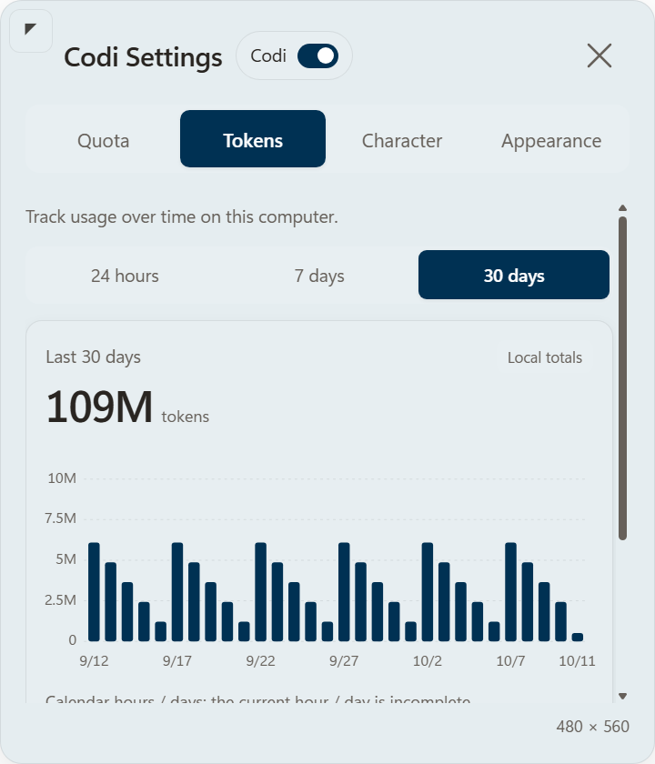

# CodexOshi

[English](README.md) | [中文](README.zh-CN.md)

**让喜欢的角色，陪你使用 Codex。** 一个能看额度、查本机 token 用量的桌面挂件。

[下载 Windows 版](https://github.com/Chester-chs/CodexOshi/releases/latest) · [使用指南](docs/guide.zh-CN.md)

<p align="center">
  
  
</p>

*示例角色由 GPT 生成，截图数据仅供演示；安装包不附带该角色。*

## 能做什么

- 一眼查看剩余额度和重置倒计时。
- 查看最近 24 小时、7 天、30 天的本机 token 用量。
- 上传喜欢的动漫或游戏角色，推荐**透明背景的 Q 版形象或立绘**。
- 自定义配色、对话和点击音效。
- 拖动、固定、调整尺寸，也可以只显示额度条。

## 怎么安装

适用于 **Windows x64**，请先安装并登录 Codex 桌面版。安装过程需要联网。

1. 从 [Releases](https://github.com/Chester-chs/CodexOshi/releases/latest) 下载 **CodexOshi-Setup-*-win-x64.exe**。
2. 双击运行，等待安装完成。**不用另外安装 Node.js 或 Git。**
3. 完全退出并重新打开 Codex，新建一个聊天，点击挂件齿轮开始设置。

已有 **Node.js 24+、npm 和 Git**？可下载更小的 **CodexOshi-Node24-Git-*.zip**，解压后双击 **Install-CodexOshi.cmd**。

已经装过？直接在 **CodexOshi 设置 → 额度管理 → 检查更新 → 一键更新** 中升级。

*安装包尚未签名，Windows 可能显示信任提示。*

### 也可以让 Codex 帮你安装

在 Codex 本机聊天中发送：

```text
请帮我在这台 Windows 电脑上安装 CodexOshi：https://github.com/Chester-chs/CodexOshi。
使用最新 Release，并校验 SHA256SUMS.txt。如果已经安装，请升级并保留角色与设置。
安装后确认挂件能显示；如需重启 Codex，请提醒我自行重启。
```

## 怎么用

- **齿轮**：打开设置，上传角色、开启或关闭挂件。
- **图钉**：切换固定，亮起表示已固定。
- **人物**：点击显示对话，再点气泡切换下一句。
- **快捷键**：`Tab` / `Shift+Tab` 切换控件，`Enter` / `Space` 操作，`Esc` 关闭设置。[完整键位](docs/guide.zh-CN.md#设置卡片快捷键)

图片留在本机；token 图表统计本机现有会话，并非账户总量。挂件读取用量，不生成模型回复，也**不会使用重置卡**。请使用有权使用的角色素材。

[详细使用与卸载](docs/guide.zh-CN.md) · [实验性 macOS 说明](macOS使用说明.txt) · [MIT 许可证](LICENSE) · [第三方许可](THIRD_PARTY_NOTICES.md)

感谢 [@dennis940](https://github.com/dennis940) 贡献实验性 macOS 移植。
