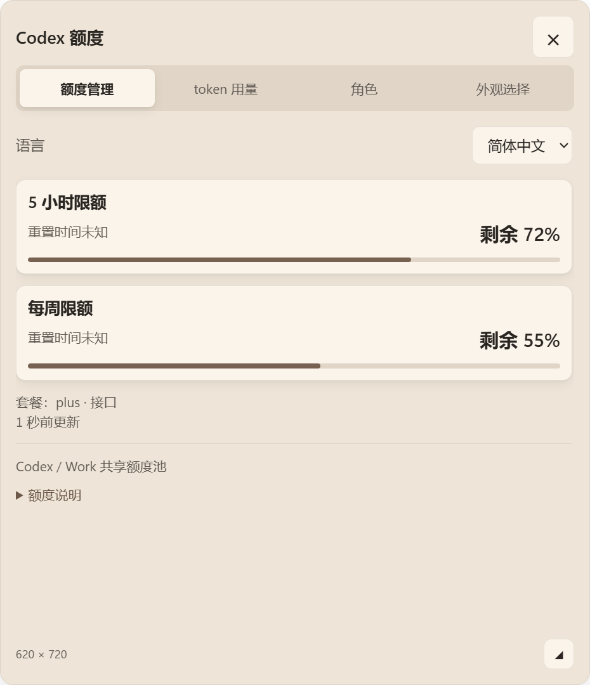
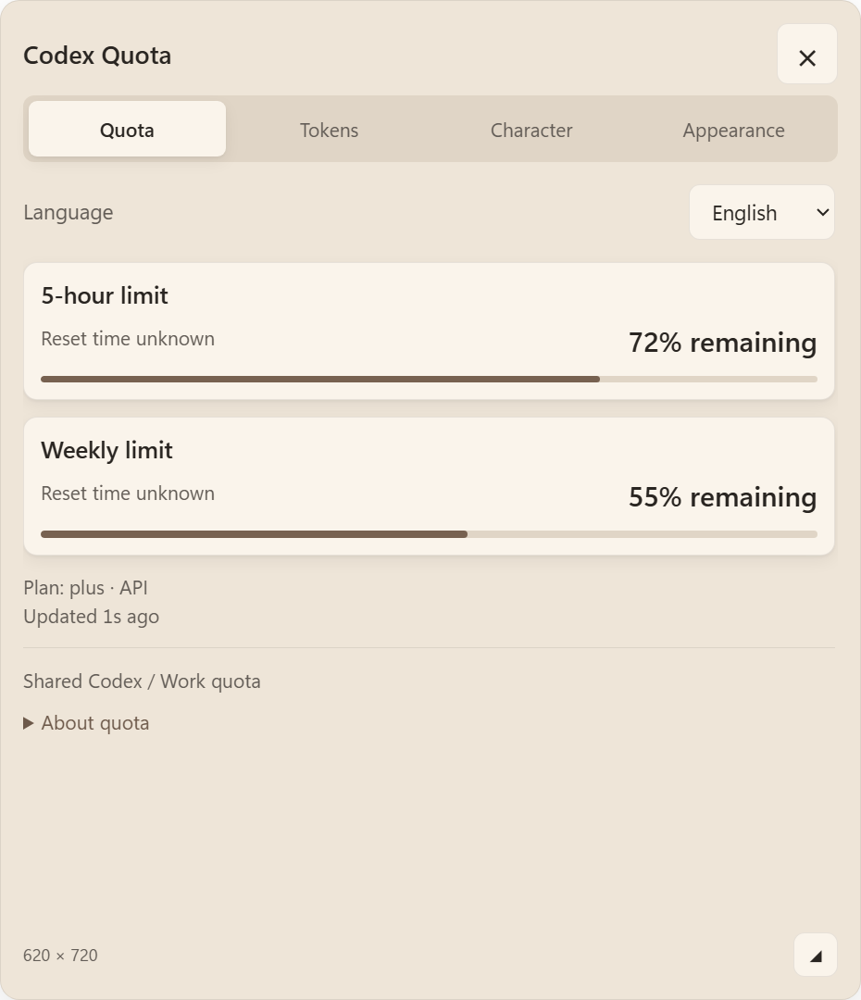

# 卡片尺寸、顶部操作与语言选择

2026-10-10，基线 733f37b。用户要求详情卡片可调大小、关闭按钮放大、四页签拉宽，并在第一页提供语言选择。本轮保留单窗口、单击直接展开的方式；未 push。

## 实现

- 默认 480×560 DIP。拖动右下角32×32手柄连续调整，范围宽360–760、高360–800；可用方向键每次调整20。左上角尽量保持，接近宿主边界时沿用 position() 夹紧。调整后的偏移在本次运行中跟随角色移动，重启依照角色位置重新摆放卡片。
- 右上角关闭按钮为44×44 DIP、28px符号，移动到标题栏。四个页签等宽铺满卡片；默认宽度下每个106.67 DIP、至少40高。关闭、页签和手柄固定，只有 panel-body 滚动；新区域继续使用原有 C# 滚轮转发。
- “额度管理”第一页提供简体中文与English。标题、四页说明、角色控件、配色名称、动态额度/重置/更新时间、token时段与常见错误即时切换；角色名和用户素材保持原样。选图、更名和删除对话框也按当前语言显示标题与按钮。字体继续使用本机系统字体。
- 独立文件 panel-preferences.json 保存 `{width,height,language}`，与角色、位置、配色、额度及token索引分离。固定路径、4KiB读取上限、枚举/整数验证、外来sender拒绝、符号链接拒绝与异步原子写入。损坏或无效设置回默认。
- 尺寸更新按requestAnimationFrame合并，主进程布局通知按16ms合并；更新事件不保存设置或诊断，不 stringify。松手保存一次并更新诊断。原角色拖动仍零写盘。

## 几何安全边界

按本次允许调大卡片的要求，将面板硬兜底从500×560改为760×800；默认仍480×560。角色兜底672×420未变，合计面积硬上限从562,240调整为890,240 DIP²。

没有删除或跳过任何校验：每个矩形仍必须为有界整数、在视口内且避让右/下24 DIP、尺寸不超过本次实际布局预算；数量最多为角色与卡片两块；总面积同时受实际预算和硬上限约束。超过760×800的面板profile、超过实际profile的矩形、整窗、空/非法区域均回退1×1。原边界回归测试相应改为新上限加一，仍验证越界拒绝。小宿主会夹紧实际尺寸，不覆盖用户保存的目标尺寸。

## 实测

新增 card-preferences.test.cjs 在旧版因固定480宽、缺少resize IPC和英文转换而失败。最终 `scripts/verify.ps1 -Native`：79/79通过，10例真实Electron异常形状仍为1×1 DIP（本机窗口144DPI时2×2物理像素）。

| 项目 | 证据 |
| --- | --- |
| 真实指针调节 | 隐藏的生产Electron窗口内，按下手柄、10步移动、松开：480×560 → 620×720；实际CSS、region与保存文件一致 |
| 热路径 | 120次实际main的resize update：0次写盘、0次JSON.stringify；end后设置文件1次保存 |
| 原角色拖动 | 既有120事件零写盘回归仍通过 |
| 关闭按钮 | 44×44，点击收起后region只剩角色；滚动时按钮y坐标保持96.67 |
| 页签 | 四个宽度均106.67，至少40高，默认尺寸无文字水平溢出 |
| 语言 | 四页签变为Quota/Tokens/Character/Appearance；额度标题、token标签、上传/去背景/素材说明和配色名称均为英文；原统计值不变 |
| 滚轮 | 原生Electron mouseWheel输入到新滚动区域后scrollTop增加；顶部关闭位置不变 |
| 小视口 | 320×250时全部region在8到右/下24边距内；保存的640×720目标值不被覆盖 |
| 重启 | 新Electron PID读取640×720、en-US，并恢复相同CSS尺寸及HTML语言 |
| IPC | 外来sender读返回null，语言修改返回ok:false；不支持的语言被拒绝 |
| 回归 | Invoke-PopupSmoke四页签/token/小视口通过；Invoke-DirectUploadSmoke空库上传/取消/错误/重名/原图不变通过；Invoke-AppearanceSmoke六配色对比度≥4.5071且配色额外setShape=0；Invoke-PortraitSmoke大小180/281/420、切换后保存、白色主体保留、极端比例、滚轮与素材说明可见、拖动0次重渲染均通过 |

原始证据在运行时 stage-5a-card/card-ui.json、restart.json、resize-events.json、wheel-debug.json，以及各回归测试目录。使用自绘几何占位图与固定示例数据，额度/token边界为测试替代，不读取真实账户；真实main、UI、IPC和设置存储均运行。

测试中发现隐藏窗口切换页签后需先capturePage提交新滚动命中表面，才可注入滚轮；模拟按住鼠标移动也必须携带leftbuttondown，否则浏览器看到buttons=0而释放指针捕获。两者均修正测试输入，未为此改生产滚轮/拖动方案。

未注入用户鼠标、未重复10分钟静置、未宣称新的实机焦点/宿主外输入探针通过。focusable:true、C#80ms恢复、原数据读取允许清单和本机图片约束保留。没有新的网络路径、依赖、MSVC或agent turn。

## 效果

## 安装

已 stop。Codex CLI 0.162.0-alpha.17.2 的 plugin add 仍返回 `failed to back up plugin cache entry: 拒绝访问。(os error 5)`，因此沿用先备份差异、再逐文件同步既有安装缓存的方式；151/151 SHA256一致，没有额外插件文件（不计.git元数据）。随后从缓存 start 成功。哈希清单为运行时 card-resize-cache-hashes.json；备份在运行时目录。未主动改写用户角色、原图、配色或位置文件。
