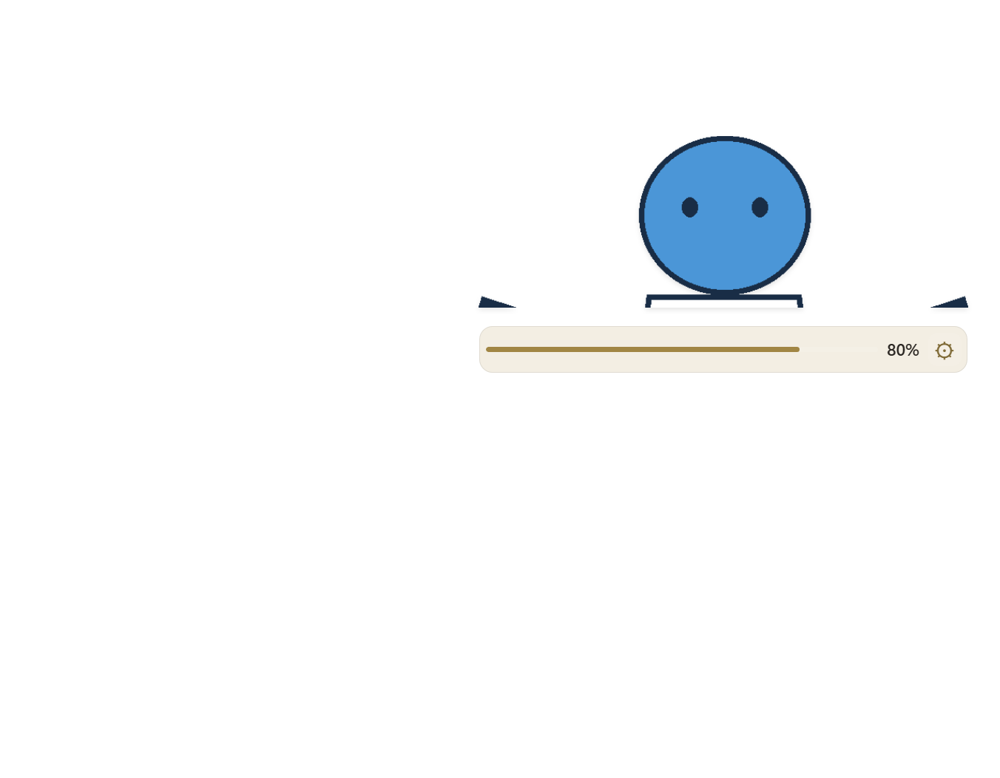
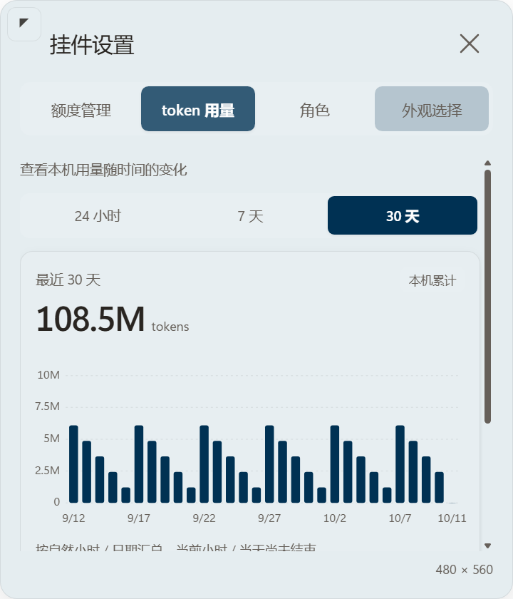
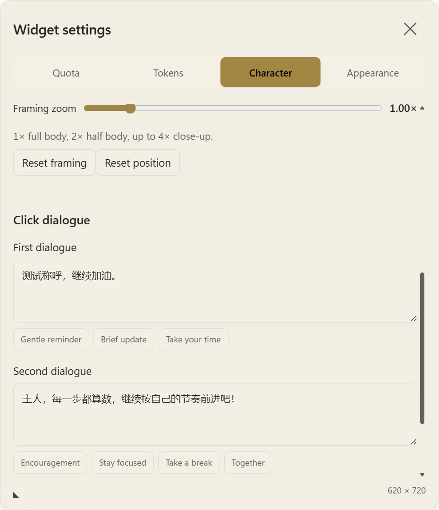

# 近景取景、对话字段与时间选项修正

日期：2026-10-11。基线：`bda2290`。本次对应用户的三个反馈：立绘近景不够大、去掉独立“称呼”输入框、token 时间范围选中不清楚。此前记录保留，以本页为本次行为的补充。

## 修改

- 取景滑杆支持 0.5–4×；1× 为全身，2× 为半身，更高倍数用于胸部以上近景。选取源图顶部的 `内容高度 / zoom`，保留头顶和完整横向范围；平移仅使用留白，不裁掉头顶或两侧。图片没有人体识别，具体胸部位置取决于素材，可用滑杆连续调节。
- 近景宽度达到 `目标高度 × 1.6` 上限时保留目标高度，以 contain 绘制所选内容；避免继续放大却因窗口高度反算而缩小。全身模式及极端比例的原有处理保持。672×420 DIP 全局上限、视口夹紧、面积校验及异常 1×1 回退不变，`geometry.cjs` 未改。
- 对话设置删除独立“称呼”输入，只保留两段文本；需要称呼时直接写在句子里。旧 `{称呼}` 在编辑器中展开为旧称呼，保存时保留兼容元数据。启动不改写已有对话文件，旧模板仍可正常读取。未知/已到期重置时间的内置提示兼容展开后的预设文本。
- 时间范围选项及语言选项使用强调色实心底、对应高对比文字和 600 字重；鼠标悬停不覆盖选中状态。图表分桶和统计数值未改。

## 验证证据

1. 修复前时间范围回归失败：克莱茵蓝下“24 小时”选中块与容器背景对比为 **1.010230258634**，几乎不可辨认。修复后实际 Electron 中检查七个预设与深色自定义，每组切换三个时间范围并分别测试悬停/非悬停，**48/48** 通过；最低选中块对比 **3.0709808958757265**，最低文字对比 **4.557037049606693**。始终只有一个选中项，切换配色及时间范围未增加 setShape 调用，region 保持不变。
2. `scripts/verify.ps1 -Native`：**106/106** 测试通过。包括近景 IPC 非法参数拒绝、4× 设置保存/重载、对话两段状态与空白处关闭后重新从第一段开始、拖动热路径零写盘、最小化位置保留、默认右下角等回归。实际 Electron 的 **10** 个异常形状案例回退为 1×1 DIP（本机窗口 DPI 144，对应 2×2 物理像素）。
3. `tests/Invoke-PortraitSmoke.ps1`：实际滑杆调到 4× 后持久保存，目标 280 DIP 的常驻尺寸为 **448×280**，选取源图 `[0,0,631,220.5]`，没有顶部/横向裁切。进度条与立绘区域相隔 6 DIP。180/280/420、切换角色、白色服饰、极端比例、滚轮和 120 次拖动不重建卡片均通过。几何单测中 627×882 素材从 2× 到 4× 的绘制缩放从约 0.499 增到 0.702，增长超过 30%。
4. `tests/Invoke-CardSmoke.ps1`：独立称呼输入不存在；直接在第一段输入文本、保存、取消编辑及预设通过，保留旧称呼元数据，不创建第二个窗口。关闭、四页签、双语、两段气泡、滚轮和卡片缩放通过。`-Restart` 重新启动后文字、语言与卡片尺寸恢复。
5. 以上隐藏窗口使用几何占位图片及合成额度/token 数据，不读取真实额度、不上传图片。C# 80ms 焦点恢复、拖动事件处理和网络路径未改。隐藏窗口检查不替代实际用户窗口的 300ms 焦点及形状外输入探针；本次尚未获得新的鼠标暂停确认，现场探针待复测。

原始证据在运行时目录 `stage-5a-ui/appearance-ui.json`、`stage-4a-ui/portrait-ui-smoke.json`、`stage-5a-card/card-ui.json` 和 `stage-5a-card/restart.json`。复现命令均在仓库运行，PowerShell 参数为 `-NoProfile -ExecutionPolicy Bypass -File`，分别调用上述脚本。

## 部署

按既有 stop → 更新缓存 → SHA256 → 缓存 start 流程部署。源码与缓存 **190/190** 个文件 SHA256 一致，角色目录的 **3** 个文件与外观偏好共 **4/4** 个文件部署前后哈希不变。缓存启动 PID 为 **13716**，`visible=true`、`focused=false`，从缓存 `desktop/main.cjs` 运行。实际当前保存的 zoom 为 **1.5**、目标高度为 **301**，没有强制覆盖用户取景；当前 region 为 **322×301 @ (1361,694)**，视口为 **1707×1019**。3–4× 的近景效果已在几何素材上验证，用户可用滑杆继续调节。原始部署证据为运行时目录 `closeup-range-deployment.json`。源码文档补记后再次同步缓存并核对全部哈希。

## 效果

以下截图仅使用仓库几何占位素材与合成数据；黑色区域是截图透明背景。

