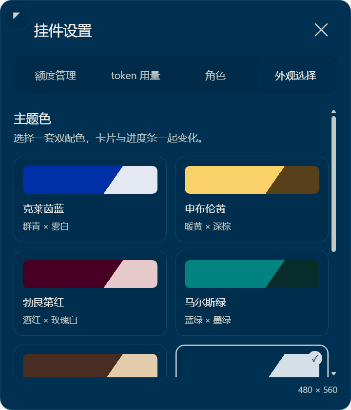

# 自定义配色继承与七组 RGB 配色修正

后续柔和配色、上半身与页签调整见 [最新验收记录](soft-theme-upperbody-verification.md)。本页保留这一轮的历史证据。

基线：`ebd8889`。这是上一轮外观改造的后续修正；旧的灵感配色和圆框关闭按钮已由本页方案替代。未 push，`v1.0` 回退点保留。

## 跳色根因与修复

`appearance-settings.js` 将 custom 初始化为固定的 `#e9e5df / #786c60`，点击自定义直接保存这两个值，未读取当前预设。实际 Electron 回归先复现：选梵高星夜后，期望继承 `#202d49 / #e8c96b`，实际却落成棕白色，断言失败。

修复后，从任一预设进入自定义时复制当前实际底色和强调色；已处于自定义时再次点击不会重置。切换预设会清除旧取色面板状态。预设与自定义采用相同的卡片层次推导和悬停底色，避免进入自定义时发生视觉跳变。色块仍展开页内 HSV 色盘，十六进制输入和 150ms 合并保存保留。

## 用户指定的七种配色

以下 RGB 由用户提供，作为卡片主色精确使用；文字、按钮和强调色另行配对并校验对比度，不将它们声明为统一的官方颜色标准。

| 名称 | RGB | 卡片主色 |
| --- | --- | --- |
| 克莱茵蓝 | 0, 47, 167 | #002fa7 |
| 申布伦黄 | 251, 210, 106 | #fbd26a |
| 勃艮第红 | 71, 0, 36 | #470024 |
| 马尔斯绿 | 1, 132, 127 | #01847f |
| 凡戴克棕 | 73, 45, 34 | #492d22 |
| 普鲁士蓝 | 0, 49, 83 | #003153 |
| 提香红 | 212, 72, 72 | #d44848 |

保留原有七个内部 palette ID，已保存的预设选择仍有效，展示名称和色值更新为新方案。原有自定义色值不改写。常驻进度条底衬使用不透明主色，避免马尔斯绿等临界亮度颜色与宿主混色后破坏文字对比。

## 关闭按钮

44×44 DIP 点击区域保留；叉形跨度由 20 缩为 16 DIP，使用 1.65 的圆角笔画和次级文字色。静止时无圆框或实心底衬，悬停时出现 26 DIP 的柔和圆形底衬，26:16≈1.625。标题对齐和关闭逻辑不变。

## 实测

- `scripts/verify.ps1 -Native`：102 项单元测试通过，10 个原生 Electron 异常形状仍回退 1×1 DIP。
- `tests/Invoke-AppearanceSmoke.ps1`：七个预设分别切换到自定义，实际 CSS 底色、上层卡片色、凹陷色、悬停色与强调色均保持一致，保存文件与输入框正确继承；再次选择自定义保留编辑结果。页内色盘实际 Chromium 鼠标输入、键盘色值编辑、保存和页面重载通过。
- 七组最低文字对比度为 4.500937710158648；配色切换的 setShape 调用为 0，region 保持 `[200×280,480×560]` 两个既有矩形。
- `tests/Invoke-CardSmoke.ps1`：44×44 关闭点击区域、关闭动作、滚轮、四页签、中英文、页内对话编辑与保存/取消、缩放方向及小视口夹紧通过。
- 未修改 geometry、主进程拖动路径、C# 焦点恢复、额度读取或网络路径。未使用用户角色素材制作截图。现场普通点击焦点及形状外输入探针仍待鼠标暂停，未标为通过。
- 扩展七种继承测试后，曾因测试桥超过 3.5 秒未心跳而提前退出。已补测试心跳，并让包装脚本在启动前清除旧结果、退出后必须检查新结果存在，避免旧报告误判；最终新报告明确记录 `inheritsAllSevenPresets=true`、`reselectKeepsEdits=true`。

## 安装与效果

按已授权流程停止挂件、按源码清单更新缓存、逐文件核对 SHA256、从缓存启动。源码与缓存 **183/183** 个文件一致；用户角色目录 **3/3** 个文件部署前后哈希相同，外观偏好文件未被改写。

