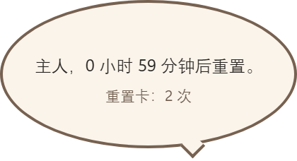
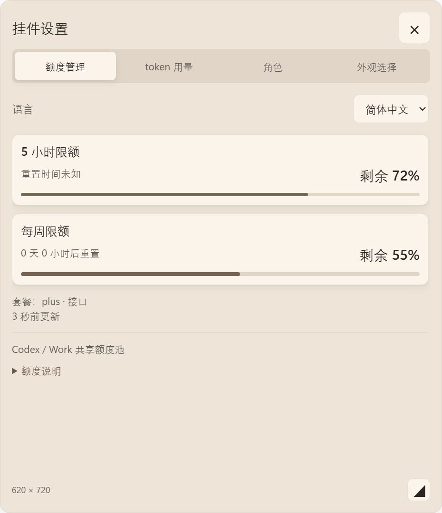

# 立绘对话、设置入口与最小化位置修复

日期：2026-10-10。基线：`e439c42`。Codex CLI：`0.162.0-alpha.17.2`。

## 最终交互

- 点击立绘轮换两段对话，不再打开四页卡片。保留点击计数、220ms 渲染层反馈及拖动。
- 气泡为 **280×152 DIP 的小椭圆**，默认第一段“主人，{重置时间}。”，下方显示可用重置卡次数；不重复百分比、标题或倒计时。第二段默认“主人，额度消耗好快呀，记得歇一歇。”。
- 第二段只显示节奏提醒，不显示公共倒计时或重置卡信息栏；第三次点击回到第一段时恢复该信息栏。自定义两段文案仍按用户设置保留。
- 气泡关闭即结束本轮：无论先前点击了一次还是两次，再点击立绘都先显示第一段重置信息。只有气泡仍显示时才轮换到下一段；点击设置齿轮也会结束这轮对话。
- 底部额度长条后的齿轮打开“挂件设置”，保留额度管理、token 用量、角色、外观四页及尺寸、语言、主题功能。气泡和设置互斥。
- 角色页的“编辑对话”可修改称呼和两段文案。使用本机原生输入对话框以支持键盘与中文输入法，不取消常驻挂件的 80ms 焦点恢复。称呼上限32字、每段240字；本机 `dialogue-preferences.json` 原子保存，不覆盖角色、素材或位置文件。自定义文案按原文保留，不因语言切换而重写。
- 支持 `{称呼}`、`{重置时间}`、`{重置卡次数}`，也保留可选的 `{剩余额度}` 替换；默认第一段不使用剩余额度。
- 点击气泡/设置形状之外自动收起。现有 C# `WH_MOUSE_LL` 仅观察左右键按下，按原生窗口 region 判定外部位置，通过现有认证管道传递一个合并布尔信号；该分支始终继续 `CallNextHookEx`，不吞事件、不注入宿主输入、不建立透明全客户区点击层。

## 重置卡数据

此前误以为缺少可读取的次数，实际是本插件的标准化过程丢弃了官方 RPC 字段。已保留 `account/rateLimits/read` 返回的 `rateLimitResetCredits.availableCount`，只保存次数、观测时间和陈旧标记，不保存 credit ID 或详情。

真实账户只读实测结果（不由截图硬编码）：

```json
{"source":"rpc","resetCredits":{"availableCount":2,"observedAt":1791664427461,"stale":false}}
```

安装缓存运行进程也读到 `availableCount: 2`。无论额度 HTTP 是否成功，每五分钟最多读取一次已有允许清单中的 RPC；已有 HTTP 额度优先级不变，零次数是合法值。失败保留旧值并标记待更新；字段缺失显示未知，不推算次数。

没有新增 HTTP URL、RPC 方法、消费重置卡按钮、凭据刷新写入或图片上传。仍只发 `initialize` 和 `account/rateLimits/read`，没有 `turn/start`、`codex exec` 或 `review`。

官方字段依据：[OpenAI Codex rate-limit RPC 测试](https://github.com/openai/codex/blob/main/codex-rs/app-server/tests/suite/v2/rate_limits.rs)。

## 最小化根因与修复证据

`WindowApi.Capture()` 最小化时仍读取并发送客户区 bounds，但报告 `visible:false`。旧 `sync()` 未检查可见/附着状态，继续转换临时尺寸并调用 `updateShape()`，夹紧坐标后还可能写入 `position.json`。

执行真实主进程生命周期/认证管道回归测试：初始位置 `(300,200)`，发送 `visible:false`、`160×28`、96 DPI。旧代码将 x 改为 **135**（回归测试明确失败）。修复后隐藏/未附着期间不改变视口及布局坐标、不保存位置；还原为 `800×600` 后仍为 `(300,200)`，最小化阶段 position 写入 **0**。保留真实可见视口变化时的既有夹紧行为。

该测试与实机最小化不同：实机三次循环、真实鼠标点击和焦点验收尚待暂停操作后执行，不能据模拟结果标为实机通过。

## 自动化验证

| 项目 | 实测结果 |
| --- | --- |
| 单元/生命周期/存储/额度回归 | **85/85 通过** |
| 真实 Electron 异常 shape | **10例通过**，1×1 DIP；144 DPI下原生region为2×2物理像素 |
| 真实 Electron 立绘点击 | 第一、第二、第一段顺序轮换；3次点击计数；卡片保持关闭 |
| 气泡 | 280×152；测试快照重置卡2次；第一段不显示剩余百分比 |
| 齿轮 | 原生 renderer 鼠标输入点击后仅打开设置，气泡收起；不增加立绘点击计数 |
| 外部关闭信号 | 认证管道 `outsideClick:true` 收起设置；此项不替代低层鼠标钩子的实机输入验证 |
| 卡片回归 | 指针调整480×560→620×720，键盘调整640×720；保存及新进程重载通过；关闭44×44、四页等宽、英文、滚轮、小视口夹紧通过 |
| 上传入口 | 无角色时可上传、重复名称保留旧图、取消/非法图不建角色、即时显示均通过 |
| 外观回归 | 六套配色、最小对比度4.507、主题变化0次shape调用通过 |
| 自定义存储 | 两段限制、稀疏数组/非法值拒绝、原子保存及重读、损坏文件回退通过；原生中文编辑体验待用户确认 |

气泡复用第二个受限 region；几何逐矩形校验、当前尺寸面积预算、全局兜底上限及异常1×1回退未放宽。气泡新增可见区域是交互布局变化，220ms 点击反馈动画自身仍只作用于 canvas transform。

## 拖动性能

`tests/Invoke-DragIoSmoke.ps1 -Baseline e439c42`：真实隐藏 Electron，隔离运行目录，模拟120次相同 gesture 事件；记录实际同步写盘调用和主进程总处理时间（不是显示延迟）。

| 场景 | 修复前 | 本次 | 拖动中写盘 |
| --- | --- | --- | --- |
| 视口内120事件 | 39.15ms | 33.37ms | 双方均0 |
| 越界夹紧120事件 | 17.55ms | 18.48ms | 双方均0 |

松手后 position/诊断各写一次，位置正确。另运行 `node tests/measure-drag-io.cjs`：120事件0写盘/0 JSON 序列化；6秒720事件仍为诊断12次、位置4次计时器检查点。保留长拖超过3秒后每秒位置兜底。

## 本机交付与待验项目

`codex plugin add codex-quota-widget@personal --json` 再次返回缓存备份拒绝访问（Windows error5）。停挂件后备份变更缓存文件并按文件同步，未删除/重命名整个缓存，未结束其他 Codex/MCP 进程。首次同步使用了缓存仓库的旧文件清单，漏掉新增模块；已停挂件并改为显式源码仓库文件清单后补齐，确认真实缓存进程成功启动并读取2次重置卡。最终源码与缓存 **161/161 文件逐文件SHA256一致**，无额外缓存文件（忽略缓存自身.git元数据）。核对报告在运行时目录 `dialogue-cache-hashes.json`；真实缓存进程7276可见、attached:true、focused:false，原生跟随钩子enabled:true、error为空。

尚未实测：本机原生对话框中文输入/保存体验、真实鼠标的外部点击关闭、100/300/1000ms焦点恢复与形状外穿透、实际最小化还原三轮。已准备 `tests/Invoke-DialogueProbe.ps1`，需先暂停鼠标；常规点击/拖动探针仍为 `tests/Invoke-MouseProbe.ps1 -Label dialogue-final -RequirePass`（不用旧语义的 `-ExpandDetails`）。不把待验项写成通过。本轮未重复10分钟静置观察。

效果图使用仓库的可自由分发白裙几何占位素材，不包含用户角色。





## 第二段信息栏与字体修订

日期：2026-10-10，修订基线 `f78e9a8`。

根因：`renderSpeech()` 无论当前是哪段对话都渲染公共 `.speech-data`，因而第二段节奏提醒也附带倒计时和重置卡。现按 `speechIndex === 1` 隐藏整个公共信息栏，正文居中；再次切回第一段时恢复。未改动几何、shape、点击计数、设置入口或拖动处理。

界面统一采用本机已安装的 **Noto Sans SC（思源黑体）**，覆盖气泡、常驻额度数字、四页设置、按钮和输入框；未安装该字体的机器按本机字体栈回退，不下载字体。正文及气泡为400常规字重，标题、选中页签及关键数字从600减为500，禁用合成粗体。原生“编辑对话”也使用 Noto Sans SC 10pt Regular，缺失时回退 Microsoft YaHei UI；已验证本机实际创建出的字体为 Noto Sans SC / Regular，并通过 PowerShell 语法解析。原生输入/中文输入法体验仍待用户确认。

可复现检查：

```powershell
powershell.exe -NoProfile -ExecutionPolicy Bypass -File tests/Invoke-CardSmoke.ps1
powershell.exe -NoProfile -ExecutionPolicy Bypass -File tests/Invoke-PopupSmoke.ps1
powershell.exe -NoProfile -ExecutionPolicy Bypass -File scripts/verify.ps1 -Native
```

- 回归测试先在旧代码明确失败：第二段信息栏实际 `display:flex`，预期 `none`。修订后真实 Electron renderer 点击第一→第二→第一全部通过：第二段 `display:none`，第一段恢复 `display:flex`，3次点击计数；气泡仍为280×152，第二段 region 与第一段逐字段相同。
- 气泡 computed font family 首选 Noto Sans SC，正文 weight400。卡片关闭按钮44×44、四个等宽页签、480×560→620×720指针调节、640×720保存、中英文切换、角色页滚轮及小视口夹紧通过。
- 四个页签无横向溢出；token 大数值在三种测试配色下无溢出；主题变化0次shape调用。已检查下方更新的气泡和设置截图，使用隔离测试数据及自由分发几何占位图。
- **85/85** 单元回归通过，**10例**真实 Electron 异常shape回退通过（144 DPI下原生region为2×2物理像素，即1×1 DIP）。不以这些检查替代尚待验收的实机鼠标焦点、穿透和最小化循环。

本轮仅修改渲染和字体及其验收文件，没有新增网络路径或图片上传；没有运行 `codex exec` / `review`，未重复10分钟静置观察。

交付：停挂件后标准 `codex plugin add` 仍返回缓存备份拒绝访问（Windows error5），已将8个变更缓存文件备份后逐文件同步。源码与缓存 **161/161 SHA256一致**，无额外文件（忽略.git），报告 `dialogue-font-cache-hashes.json`。新版实际从缓存启动，PID18908，visible:true、attached:true、focused:false；位置仍为 `(1483,715)`。没有删除用户文件或结束其他 MCP 进程。

## 关闭后从第一段重新开始与苹果式字体修订

日期：2026-10-10，基线 `c7597dc`。

原点击处理只按累计序号 `(speechIndex+1)%2` 轮换，未考虑气泡是否已经关闭。现在点击前检查 `speechVisible`：关闭状态从0开始；仍显示时才轮换0→1→0。不改计数、关闭信号、几何或拖动热路径。

新增两项主进程回归：分别点击一次/两次、经认证外部点击信号关闭，再点击必须回第一段；还覆盖显式关闭、打开设置后关闭。旧代码在这两项回归中均失败，修订后通过。真实 Electron renderer 输入也通过“一次→关闭→第一段”“第一段→第二段→关闭→第一段”，第一段信息栏恢复 `display:flex`，第二段保持 `display:none`；总共6次立绘点击，齿轮不计数。这里的外部关闭由认证管道注入，不替代实机低层鼠标验证。

参考 [Apple 官方字体说明](https://developer.apple.com/fonts/) 的 SF Pro 系统字体、可变字号与清晰排印原则。本机 Windows 采用 **Segoe UI Variable Text** 显示英文/数字，中文优先 **等线（DengXian）**，替换上一轮中文首选 Noto Sans SC 的效果；苹果平台字体栈保留系统字体/SF Pro Text/PingFang SC。使用已有本地字体，不下载或打包苹果字体。正文400、强调500，禁用合成粗体；气泡正文从15改为16px、行高1.6，辅助信息14px，设置标题20px。原生编辑器本机中文实际字体为等线 Regular、英文为 Segoe UI Regular（10pt），PowerShell语法解析通过。

复测 `tests/Invoke-CardSmoke.ps1`、`tests/Invoke-PopupSmoke.ps1` 通过：气泡280×152 region不变、关闭44×44、四页等宽、尺寸调节/保存/中英文/滚轮/小视口均通过，四页无横向溢出，主题变化0次shape调用。截图已更新，使用自由分发占位素材和隔离数据。`scripts/verify.ps1 -Native` **87/87** 通过，**10例**真实异常shape回退通过。既有焦点80ms恢复、允许读取清单及拖动零写盘路径均未改动；本轮未重测实机鼠标/中文输入法或10分钟静置。

停→重装时仍遇到 Windows 缓存备份error5，沿用逐文件备份/同步：8个变更文件，源码与缓存 **161/161 SHA256一致**，无额外文件（忽略.git），报告 `dialogue-cycle-cache-hashes.json`。实际缓存进程PID14232已运行，visible:true、attached:true、focused:false；保存位置仍为 `(1483,715)`。
