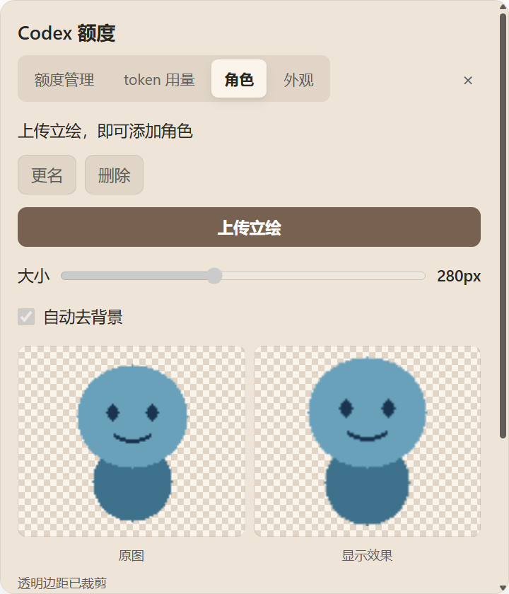

# 角色操作简化：直接上传立绘

2026-10-10，基线 801fdb7。用户要求移除「新建」按钮，直接点击「上传立绘」选图。本轮仅修改角色上传入口、自动命名与相关验证，未 push。

## 行为

- 角色页签没有「新建」按钮，没有角色时「上传立绘」仍可点击。
- 每次上传有效图片，自动按文件名（去扩展名）创建并选中角色；无须先输入名称。同名按不区分大小写的规则加序号，例如「几何」「几何 2」。长名称截短到允许范围，系统保留名称或无效名称使用「角色」。不会覆盖已有角色。
- 在创建目录之前完成内容类型、10 MiB 和单边 4096px 校验；取消选图、无效内容和超限图片不会创建空角色。
- 原文件只读一次，复制到新角色目录；图片不出本机。使用既有原子设置写入和选中逻辑，上传成功后发布角色快照并立即显示立绘。
- 更名、删除、切换、大小、去背景、缩放与平移入口保留。上传前提交原角色待保存的取景设置。未删除或迁移用户已有角色文件。

## 测试

新增 direct-upload.test.cjs 在旧版本因缺少直接上传功能而 3 项失败，实现后通过：

1. 空角色库上传后选中「几何」，图像副本与源文件字节一致；再次上传选中「几何 2」，第一张副本不变；重载恢复新选择。
2. 文本伪装 PNG、超过 10 MiB、单边 4097px 被拒绝，角色库保持空。
3. 系统保留形式及长文件名可安全自动命名，角色目录保持在本机存储根目录内。

真实 Electron 测试 `tests/Invoke-DirectUploadSmoke.ps1` 使用生产 main/renderer/IPC/CharacterStore 和隔离目录；只替代系统选图对话框、额度与 token 读取，防止测试干扰用户选图或真实账户读取。初次运行旧界面明确失败：没有角色时上传按钮 disabled=true。

修复后的原始结果：

```json
{"passed":true,"uploadEnabledWhenEmpty":true,"newButton":false,
 "cancelCreatesRole":false,"invalidCreatesRole":false,
 "names":["白裙几何","白裙几何 2"],"active":"白裙几何",
 "livePortrait":true,"originalUnchanged":true}
```

测试直接点击实际上传按钮，取消后保持空库，伪装文件显示支持格式提示；有效上传后常驻画布加载新本机 portrait 地址、设置控件启用；再次上传保留旧角色，随后点击角色列表能切回。原文件的字节和 mtime 不变。名称对话框在本测试中若被调用会直接失败，验证上传不需要额外命名步骤。

`scripts/verify.ps1 -Native`：73/73 通过，拖动热路径 120 个事件仍为零写盘；10 例真实 Electron 异常形状仍回退 1×1 DIP（窗口 144 DPI 时为 2×2 物理像素）。`Invoke-PopupSmoke.ps1`：四个页签、480×560 卡片、token 短值/精确值、配色及小视口夹紧回归通过。

原始 JSON/截图在运行时 stage-5a-direct-upload/，其他回归证据在 shape-smoke.json 与 stage-5a-popup/popup-ui.json。未使用用户角色素材，未注入用户鼠标。geometry、主窗口、C# 焦点恢复和数据读取未修改；本轮没有新增网络路径或图片上传，也没有重复十分钟静置或宣称完成新的实机焦点/宿主输入探针。

## 界面

截图使用项目自绘占位图，不含用户角色素材。



## 安装

已 stop。Codex CLI 0.162.0-alpha.17.2 的 plugin add 仍返回 `failed to back up plugin cache entry: 拒绝访问。(os error 5)`；沿用前两轮方式，逐文件备份差异并更新既有缓存。141/141 SHA256 一致，没有额外插件文件（不计 .git 元数据），从缓存 start 成功。哈希清单为运行时 direct-upload-cache-hashes.json，备份目录也在运行时目录；未改插件注册或用户角色数据。
