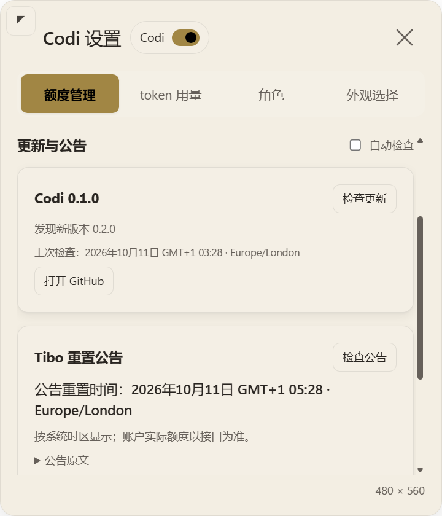

# Codi 版本检查与 Tibo 公告

2026-10-11。标题改为「Codi 设置 / Codi Settings」，更新与公告位于额度管理页。账户额度读取、两段角色对话、图像取景和已有开关继续沿用。

## 实现

- GitHub：读取固定仓库主分支 `package.json`，按语义版本比较，支持数值分段与预发布版本顺序。私有仓库遇到 404 时，通过本机 `gh api` 使用已有登录，命令和仓库路径固定；Codi 不读取登录令牌。自动检查间隔 6 小时，提供手动按钮和仓库入口，不自动安装代码。
- X：仅请求 `syndication.twitter.com` 上 @thsottiaux 的公开时间线。只接收该作者的原帖，忽略转推、无效 ID、超过 7 天的公告。自动检查间隔 30 分钟；手动检查至少间隔 1 分钟；429 尊重秒数形式的 Retry-After，并至少退避 30 分钟。失败保留先前结果并显示状态。
- 时间：在包含 reset 的语句内解析明确日期、今天、明天、星期、UTC/GMT、PT/PST/PDT、ET/EST/EDT，以及小时／分钟相对时长。PT/ET 使用 IANA 时区处理夏令时；重叠或不存在的墙上时间不猜测。疑问、条件、否定、改期、多组冲突时间及模糊公告保留为未确定时间。近似表达标为预计时间。自然语言规则有覆盖范围，不保证理解所有公告。
- 提醒：近期公告、更新版本仅提醒一次，持久化去重；网络读取完成时窗口隐藏或正在拖动，会延后从缓存投递，不提前消耗去重键。通知被系统禁用时仍可查看卡片和齿轮提示。系统时区变更后重新格式化显示。公告不会改写账户的额度或重置字段。
- 网络：固定两个读取地址，不携带 Codex 凭据，拒绝重定向，响应上限 2 MiB，设置超时。外部链接仅允许固定 GitHub 仓库及指定 X 用户主页／原帖。原文使用 textContent，关闭应用时取消待处理请求。

## 验证

- `scripts/verify.ps1 -Native`：123 项自动测试通过，10 个异常形状输入继续回退到 1×1 DIP。
- `tests/public-news.test.cjs`：12 项针对性测试，覆盖语义版本比较、私有仓库回退、无凭据 GET、429、超限响应、缓存、退避、自动检查间隔、开关持久化、通知去重／延期、退出后的晚到响应、DST、跨日、系统时区切换和公告时间边界。
- `Invoke-NewsSmoke.ps1`：隐藏的真实 Electron 界面通过版本检查、公告时间、不可执行的原帖文本、重复请求与通知抑制、中英切换、自动检查保存和链接限制。网络及系统通知边界使用合成数据，不触发用户桌面通知。
- CardSmoke、ResidentSmoke 及其重启恢复检查通过。
- 实际 GitHub 版本检查成功：当前与远端均为 0.1.0。开发时实际免费 X 时间线返回 HTTP 429。部署后的首次自动检查已成功读取时间线，状态为 ok，未筛选出近期重置公告；GitHub 自动检查亦返回 current。没有展示或通知虚构的实时重置时间。
- 独立代码复查发现并修正：跨语句错误绑定、复合时长截断、疑问／条件表达、May 月份误判，以及不可见时提前去重的问题。

截图为合成公告与合成新版本，不代表真实发布：

## 本机部署

源码与缓存 211/211 文件哈希一致；部署前后角色素材及原有偏好 7/7 文件一致。新缓存进程 PID 30692，visible=true、focused=false，挂件保持 300×253，位置 (1383,742)。新增公告缓存位于运行时 news-state.json。
