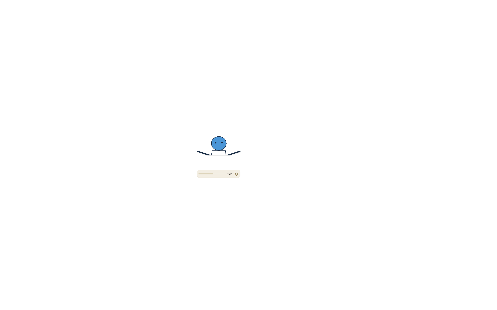

# 右下角固定、随窗口缩放与独立宽度

日期：2026-10-11。基线 `7c864c6`。用户要求挂件持续位于 Codex 右下角、小窗口中缩小，另要求独立调节人物区域与进度条的整体宽度，改变原来的取景滑杆方式。

## 行为

- 默认开启“固定右下角，随窗口缩放”。每次宿主有效视口变化都通过现有 layout/position 路径重新计算右下角，保留右边及下边 24 DIP；最小化的隐藏/1×1 边界仍忽略。
- 固定模式按 `min(1, 视口宽度×0.25/设定宽度, 视口高度×0.30/设定高度)` 计算等比缩放，避免挂件超过视口宽度的 25% 或高度的 30%。然后仍经过现有小视口夹紧和安全 shape 校验。窗口放大时恢复可容纳的设定尺寸；很大的用户设定仍受上述占用比例限制。
- 人物、字号、进度条、齿轮及间距在同一个渲染容器中等比缩小，设置卡片保持独立可读的尺寸。底部进度条继续位于立绘下方。
- 固定模式不响应拖动移动，不改写 position.json。关闭固定选项即可恢复原来的自由拖动/吸附，并恢复此前保存的手动坐标。固定偏好保存在 panel-preferences.json，不与手动位置混写。
- 取景滑杆改为“全身／半身／近景”预设，另提供 −/+ 与数值输入微调，仍支持 0.5–4×。首次修改取景时锁定当时整体宽度，之后不随取景倍数自动拉长。
- 新增“宽度”滑杆，126–672 DIP，控制人物显示区域与进度条的整体宽度，实时生效并按角色保存 targetWidth。人物按 contain 保持比例，宽度变窄时可能缩小人物，不进行横向拉伸。旧角色无 targetWidth 时仍按旧尺寸计算，启动不改写素材或角色设置。

## 验证

- 新增回归在修改前失败：保存的 `{x:80,y:90}` 导致大窗口仍显示旧坐标，未定位到 `{x:1376,y:676}`；宽度保存后读取为 undefined。修改后对应回归通过。
- `scripts/verify.ps1 -Native`：**109/109** 通过；10 个真实 Electron 异常形状仍为 1×1 DIP，本机 144 DPI 下为 2×2 物理像素。geometry.cjs 与 C# 焦点恢复未改。
- `tests/Invoke-ResidentSmoke.ps1` 使用真实隐藏 Electron、几何图片与合成额度，完整启动主进程并通过认证宿主桥传入视口。结果如下：

|视口|常驻 region|渲染缩放|进度条高度|
|---|---|---|---|
|1600×1000|215×300 @ (1361,676)|1|42|
|800×600|129×180 @ (647,396)|0.6|25.2|
|恢复 1600×1000|215×300 @ (1361,676)|1|42|

各次右下边距均为 24 DIP。最小化占位不覆盖记忆位置。固定模式 120 次拖动请求不会移动挂件或改写位置文件。自由模式 120 次拖动热路径仍零写盘、零序列化；松手保存和吸附回归通过。

- 实际角色页宽度滑杆设为 360 后，点击近景预设、+ 微调和键盘输入 3.2×，宽度均保持 360；再次调成 240 后，settings.json 保存 targetWidth=240。关闭固定选项恢复原手动 `{x:90,y:100}`；重新固定并重启，恢复右下角 **240×300 @ (1336,676)**，仍读取保存宽度。缩小后的齿轮可通过真实 Chromium 指针事件打开同一设置卡片。
- `tests/Invoke-PortraitSmoke.ps1`：完整头顶/横向范围、白色服饰、180/280/420 高度、4× 取景保留原宽度、极端比例、滚轮、120 次拖动不重建卡片通过。
- `tests/Invoke-CardSmoke.ps1`：自由模式拖动、两段对话、空白信号关闭后重置第一段、页内编辑、语言、卡片尺寸调整、关闭与小视口安全区域回归通过。
- `tests/Invoke-AppearanceSmoke.ps1`：七套配色、自定义取色、48 个时间范围选中/悬停对比、主题切换 region 不变通过。
- 真实窗口只读 Win32 检查：region 左侧间隙、上方与视口左上三个点的 WindowFromPoint 均命中宿主 root HWND **919662**（PID 24812）；当时前台也是 919662。未移动鼠标或注入输入。这验证了三个形状外点的窗口命中，不能代替滚动/选中文字及点击后 300ms 焦点时序测试。
- 所有隐藏测试使用本机几何素材及合成数据；没有新网络路径、图片上传或 agent turn。真实用户窗口的调整大小体验与 300ms 焦点、形状外实际输入尚待现场复测，隐藏测试不代替此项。

原始证据：运行时目录 resident-dock-ui/resident-ui.json、resident-dock-ui/restart.json；其余 fixture 保持此前证据目录。

## 部署与审查

stop → 更新缓存 → 缓存 start 完成，源码与缓存 **196/196** 个文件 SHA256 一致。真实用户素材、角色设置、外观/卡片偏好与原手动位置共 **9/9** 个文件部署前后哈希不变。缓存启动 PID **12780**，visible=true、focused=false，视口 **1707×1019**，常驻 **265×280 @ (1418,715)**，右/下边距各 24 DIP。原始部署证据为运行时目录 resident-dock-deployment.json。文档补记后再次同步并核对哈希。

单独检查了最大区域、无效参数拒绝、固定/自由位置隔离、旧偏好兼容、输入框焦点例外与旧拖动热路径；未放宽 shape 校验。保留 1.0 回退标签，不 push。

以下效果只使用几何占位图：

## 后续修复：倍数调节、数字输入与设置卡片稳定（2026-10-11）

移除全身／半身／近景三个预设按钮，只保留 0.5–4× 输入与 −/+ 微调。宽度（126–672）和大小（180–420）的数字改为可编辑输入框，与原滑杆双向同步，按角色保存。空值、越界值及非整数不生效，离开输入框后恢复最后有效值；编辑期间收到角色刷新不覆盖正在输入的数字。数字输入使用现有文字编辑焦点通道，不另开窗口。

复现证据：1600×1000 视口中，宽度从 215 调到 360，设置卡片 x 从 869 变成 724，移动 145 DIP。原因是每次 character-size 消息都会重新按立绘左边缘定位卡片。现在在立绘尺寸变化前记住当前设置卡片的坐标，换算为现有 panelOffset 交给原 layout／position 路径夹紧；连续修改期间保持卡片位置。重新打开设置时清除临时偏移，按当前立绘位置排列。调整设置卡片本身的尺寸仍沿用原规则。

最新实际隐藏 Electron 验证：

- `Invoke-ResidentSmoke.ps1`：预设按钮数量为 0；倍数键盘输入 3.2×、+ 微调、独立宽度均通过。宽度依次调整 360／240／280／126／672／240，大小键盘输入 320 再滑动回 300，设置 region 始终为 **480×560 @ (869,416)**。两个数字框接受真实 Chromium insertText，保存后与滑杆一致；空值、低于下限、高于上限、200.5 均不改变有效设置。
- `Invoke-ResidentSmoke.ps1 -Restart`：保存宽度 240、大小 300、倍数 3.2 正确恢复；右下角位置 **(1336,676)**。
- `Invoke-CardSmoke.ps1`：两段对话、页内编辑、语言、关闭、滚轮、卡片拖动调整和小视口夹紧通过。
- `scripts/verify.ps1 -Native`：**109/109** 通过，真实 Electron 10 个异常 shape 输入仍回退 1×1 DIP。geometry.cjs、拖动热路径及 C# 80ms 焦点恢复均未改动；未新增网络路径或角色素材。

上述输入测量发生在隐藏测试窗口，使用几何占位素材。此次未在用户真实窗口注入鼠标输入，实际点击后 300ms 的焦点时序验收仍沿用待现场复测状态。原始新证据位于 resident-dock-ui/resident-ui.json 与 restart.json。

此次 stop → 同步缓存 → start 完成，**196/196** 文件 SHA256 一致，用户素材及偏好 **9/9** 文件哈希未变。缓存进程 PID **34932**，visible=true、focused=false，恢复用户当前 **126×238 @ (1557,757)**，视口 1707×1019。部署记录仍为 resident-dock-deployment.json。
