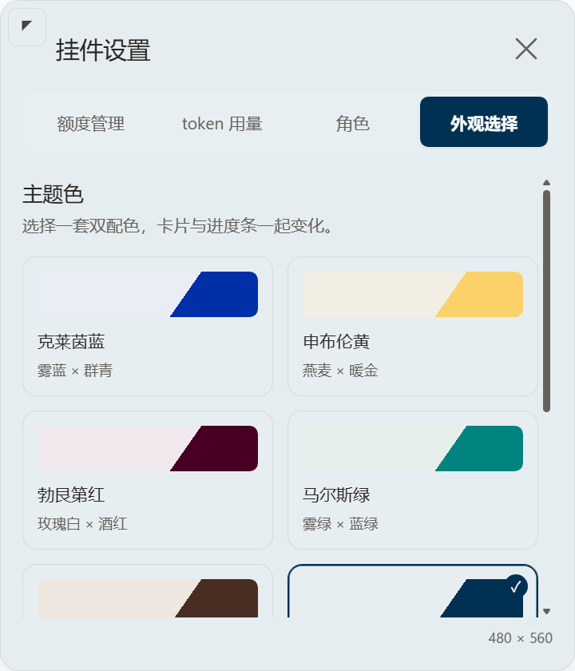
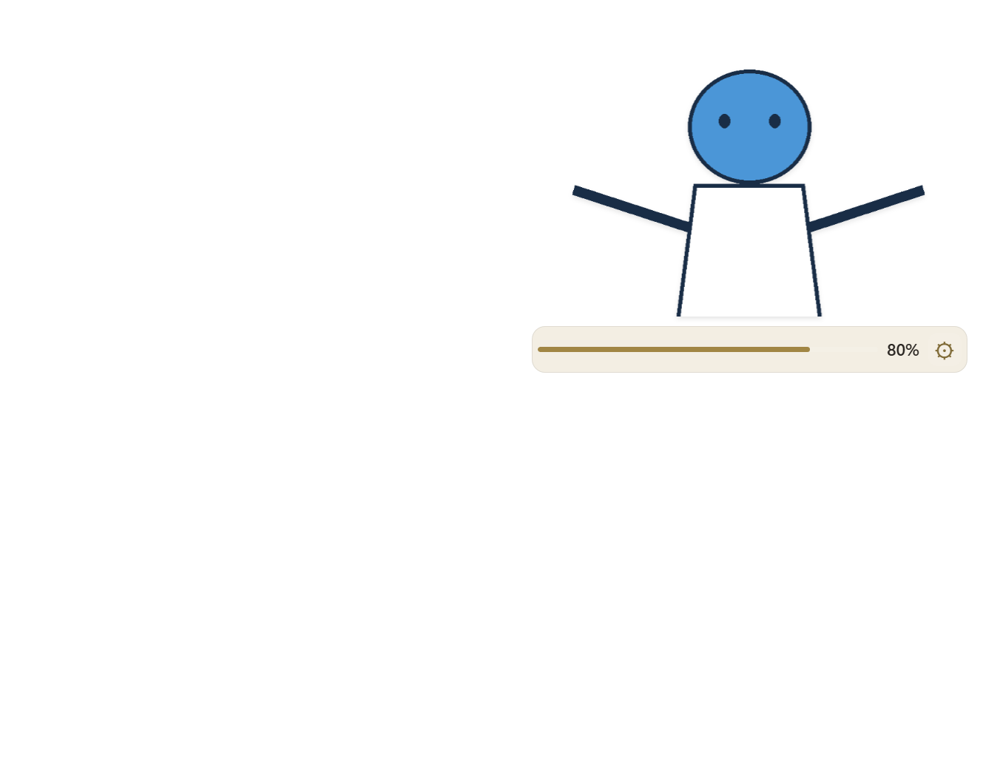

# 柔和配色、完整上半身与页签识别修正

基线：`48dbad2`。按用户新反馈修正三项：大面积高饱和底色、立绘左右/头顶被硬裁切、当前设置页签不明显。旧的验证记录保留，本页记载最新行为。

## 方案

七个预设保留名称和颜色方向，卡片回到雾蓝、燕麦、玫瑰白、雾绿、米白、灰蓝、杏白七种柔和底色；用户给出的七种 RGB 改作强调色来源。黄色等强调色在界面上按现有对比规则加深，色板预览仍显示原始颜色。自定义色值和预设进入自定义时继承当前颜色的行为保持。

选中页签改用强调色实心底与对应的高对比文字，加粗字重，悬停时仍保持选中底色。七组均实测选中块与导航底色对比至少 3:1，块内文字至少 4.5:1。

原绘制方式先放大，再将图像交集裁入固定矩形，导致左右和头顶缺失。新取景以顶部为起点保留完整横向范围，只减少图像底部的显示范围；1× 为全身，2× 为上半身，二者之间连续调节，0.5–1× 仍支持完整立绘缩小。旧设置中的 >2× 按上半身显示，启动时不破坏性改写设置文件。平移只使用绘制后的留白，不能再把头顶或左右移出画布。

角色尺寸通报使用取景后的内容宽高比，所以上半身模式会自然变宽，画布以 contain 完整显示所选内容；没有让渲染越出原生 region。进度条与画面继续相隔 6 DIP。既有宽度 672、高度 420 DIP 全局上限、小视口等比缩小、逐矩形/面积校验和 1×1 回退全部保留，`desktop/geometry.cjs` 未改。

## 验证

- 修复前回归失败：100×200 图片在 2× 模式中源图 x=17.1233、宽度不足 100；选中页签与背景对比也不足 3。修复后源范围 x=0、y=0、宽=100、高=100；所有旧平移值均保留头顶和左右。
- `scripts/verify.ps1 -Native`：103 个测试通过，10 个实际 Electron 异常形状仍回退 1×1 DIP。
- `tests/Invoke-PortraitSmoke.ps1`：180/280/420 三种高度、1.55× 及旧偏移值实测源图 `[0,0,631,569.0323]`，没有横向或顶部裁切；进度条间隙均为 6 DIP。2× 上半身模式自动变宽，大小保存、角色切换、白色服饰、极端比例、滚轮和 120 次拖动不触发卡片重建均通过。
- `tests/Invoke-AppearanceSmoke.ps1`：七组配色、选中页签、各预设进入自定义保持原色、页内取色与色值编辑、保存/重载通过。最低文字对比度为 4.503417111102607，配色切换调用 setShape 为 0。
- `tests/Invoke-CardSmoke.ps1`：关闭、四页签、中英文、页内对话编辑、预设、两段气泡、滚轮、卡片缩放与小视口夹紧通过。
- 主进程拖动热路径、C# 焦点恢复、额度/token 读取与网络路径未改。原生放宽后的形状外输入和焦点需现场探针，未用隐藏窗口检查替代。

## 安装与效果

按既有 stop → 更新缓存 → SHA256 → 缓存 start 流程部署。源码与缓存 **186/186** 个文件 SHA256 一致；真实用户角色目录 **3/3** 个文件及外观偏好部署前后哈希不变。缓存启动的 PID 为 11004，`visible=true`、`focused=false`、`textEditing=false`；当前目标高度 301、旧 zoom=3 按上半身展示，region 自然调整为 **429×301**，在 1707×1019 视口内夹紧到 `{x:1254,y:694}`，保留右下边距。用户原图和设置文件未改写。

以下截图仅使用几何占位角色与合成额度；黑色区域是截图中的透明背景。

