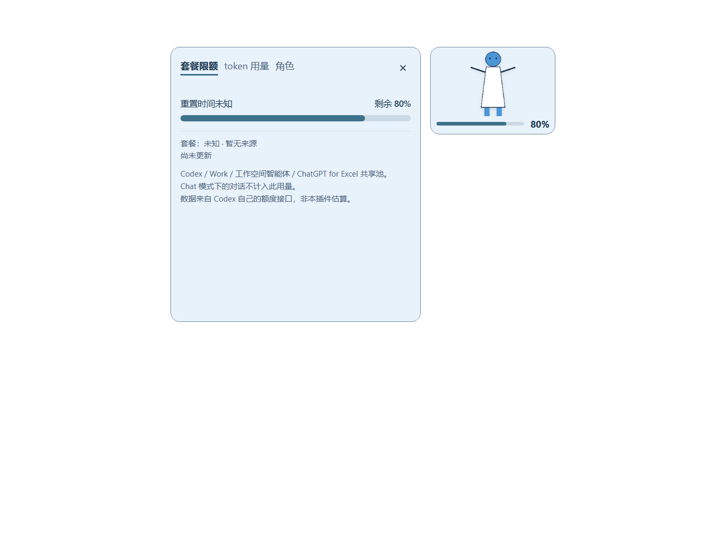
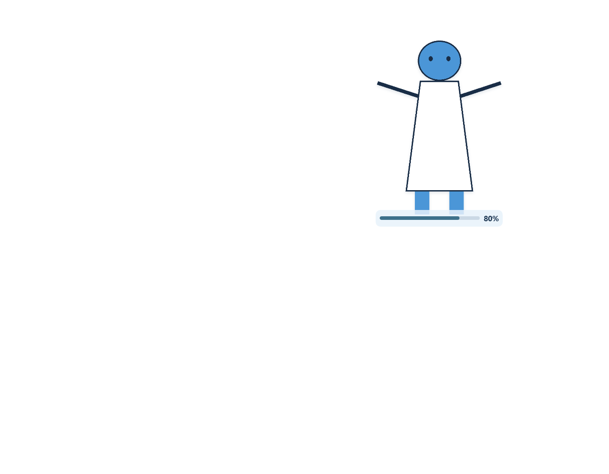

# 阶段 4a：完整立绘与尺寸改造验收

2026-10-10，基于已推送的 78122d3。Windows x64、Node v24.19.0、Electron 44.3.0；Codex CLI 实测为 0.162.0-alpha.17.2（此前从 0.156.1 自动升级）。本阶段先修改 geometry 的上限，再接入裁剪、尺寸和布局。用户测试时发现角色页签收不到鼠标滚轮，已在本阶段修复并回归。

仓库只新增本项目自绘的几何白裙立绘、纯色极端比例测试图及对应截图，均按项目 MIT 许可自由分发。用户图片只在本机读取，没有复制进仓库、修改原始字节或上传网络。

## 逐项验收

| 第 5 节编号 | 结果 | 证据 |
|---|---|---|
| 1. 上传纵向立绘后变为完整立绘 | 通过 | 正式 renderer/Worker 导入 658×939 自绘白裙图，内容 631×882，常驻态 200×280 DIP，透明窗口背景；对比截图见下文。用户操作后回复“可以探针”，未继续报告显示问题。 |
| 2. 可用高度达到 280px 量级 | 通过 | 默认目标高度 280，角色净高 257.59 DIP（92%）；改造前仅 82.67 DIP。 |
| 3. 连续滑杆实时生效、持久保存 | 通过 | 真实 input 事件设置 180/281/420，实际窗口 129×180、201×281、300×420；store 立即保存目标高度，切换另一个角色再切回仍为 420。用户测试 180→280→420，最终真实角色窗口 299×420，缓存重启后继续保留。 |
| 4. 白边裁掉、内部白色保留 | 通过 | 单元测试开/关去底均裁到预期外框且白衣像素 alpha=255，输入数组不变；真实 Worker 的白裙中心像素 RGBA=[255,255,255,255]。外缘彩色噪点停止该方向裁剪，RGB=239 不当作近白边距。 |
| 5. 底部叠加条和半透明底衬 | 通过 | 正式 CSS 底部 absolute 叠加、条高 5px，底衬 rgba(232,242,251,0.84)，暗色主题对应 rgba(20,29,40,0.84)。DOM 实测条完整位于挂件内、80% 数字可见，截图已检查。 |
| 6. 极端比例不畸形 | 通过 | 真实 Worker 的 1024×16 图得到 448×48，16×1024 图得到 126×420；底部条仍在窗口内。内容 contain 保持原比例，无拉伸。详见全局高度兜底说明。 |
| 7. 放大后形状外仍穿透 | 通过 | 在真实 299×420 挂件上，23 个 WindowFromPoint 采样点（含面板/角色间隙）全部命中 Codex HWND=919662。用户在要求确认形状外点击、滚动、选中文字后回复“可以探针”。新增滚轮探针的形状外事件没有转发到挂件。 |
| 8. 异常形状回退 1×1 | 通过 | 10 类异常输入在真实 Electron 上均回退；Win32 region 为 2×2 物理像素，窗口 DPI=144，即 1×1 DIP，测试窗保持隐藏。 |
| 9. 300ms 内恢复宿主焦点 | 通过 | 源码版 106ms 恢复；安装缓存版 121ms 恢复。缓存点击计数 2→3，100ms 采样时仍为挂件，300/1000ms 采样均为 Codex；主动切到测试自有窗口后未被拉回。完整时间线见下文。 |
| 10. 拖动、吸附、保存、夹紧 | 通过 | 缓存原生 10 步拖动 (1344,551)→(1304,527)，position.json 同步。12 DIP 吸附阈值及 160×240/800×600/1000×800 视口、多尺寸均通过有界布局测试；真实 main 的越界存档 (900,700) 被夹到并保存 (577,296)。用户完成边缘操作后确认可继续探针。 |
| 11. 展开面板未破坏 | 通过 | 真实 renderer 的 0/1/2 额度窗口面板仍为 320×214/270/352，滚到底可见本机素材声明。原角色/GIF/WebP/取景及全部 JPG/JPEG/BMP 等格式回归通过；真实鼠标滚轮已修复。 |
| 12. 零额度消耗、图片不出本机 | 通过 | 允许清单、额度 GET / 只读文件 / initialize + account/rateLimits/read 未改变，未运行任何 Codex exec/review 或 agent turn 命令。缓存版 600,021ms 静置无新增 task_started、turn_started、token_count；12 次检查均可见、附着、focused=false。图片仍仅 character:// 本机协议，CSP 无网络图片路径。 |
| 13. 改造前后截图 | 通过 | 两张截图均来自实际 Electron 与自绘几何白裙素材，无用户或动漫素材；见下文。 |

## 尺寸计算与安全边界

desktop/ui/portrait-size.js 为 main 和 geometry 共用的纯计算模块。旧角色未保存 targetHeight 时默认为 280；新参数随每个角色的 settings.json 保存，滑杆为 1 DIP 连续步进，input 时立即调整布局，150ms 合并保存，change/切换角色时刷新保存。

对裁剪后的 (cw,ch)，先限制 H 为 180–420：

```text
ratio = cw / ch
rawWidth = round(H * ratio)
width = clamp(rawWidth, round(H * 0.45), round(H * 1.60))
height = width 未被夹紧 ? H : round(width / ratio)
```

普通比例保持目标高度，避免反算四舍五入让 420 变成 419。627×882、H=280 得到 199×280；2:1、H=280 得到 448×224。极端比例的反算高度可能远超宿主或不足进度条高度，因此另保留窗口高度 48–420 的兜底：例如 1:100、H=420 得到 189×420，100:1 得到 672×48。这是窗口框的安全夹紧，图像仍 contain，不强行把内容拉成框的比例；极端超窄图会留横向空白。角色图可用高度为窗口的 92%，用户自设取景 zoom/pan 继续有效，默认 zoom=1 显示完整主体。

geometry 的逐矩形宽高上限现在使用实际布局 sizes；合计面积不能超过实际 sizes 面积。另保留角色最大 672×420、面板最大 340×352、全局面积最大 **401,920 DIP²**，最大两块矩形，正整数/坐标范围/视口 1–32768 及边界检查。非法 sizes、额外矩形、尺寸膨胀、面积超限、覆盖整窗、空形状统一回退 tiny()=[{x:0,y:0,width:1,height:1}]。从不把 [] 传给 setShape。

右侧/底侧保留 24 DIP，左侧/顶侧保留 8 DIP。视口不足时角色框同比缩小；位置夹紧后写回 position.json。加载图片早于宿主握手时暂存尺寸，等待真实视口，避免将旧位置错误夹到初始化的 1×1 视口。拖动结束才执行 12 DIP 边缘吸附。

## 白色边距与原文件保护

裁边从最外层上/下行、左/右列向内扫描，每条边带须全部为 alpha≤8 或 R/G/B 均≥240；遇到第一个非白且非透明像素，立即停止该方向。该规则比“边带大部分为白色”更保守，宁可被外缘噪点留下边距，也不越过主体。它只改变外框，不统计全图白色，也不删除内部白色像素；全白或全透明图回退原范围，避免消失。

既有纯色去底开关仍独立生效：关闭时仍裁空白外缘，开启时仍只扣除边缘连通背景。白裙测试图具备深色轮廓，裙子内部白色在两种开关下均保留。Worker 在副本中处理，工作帧长边上限由 512 提到 1024，658×939 图不需降采样；动画继续累计裁剪外框以保留移动。

用户给出的原立绘内容估计为 627×882；本机对既有 ready.png 的保守 alpha/近白边带只读计算为 (14,32,631,888)，差异来自阈值/抗锯齿边缘，H=280 同样算得约 199 宽。没有将用户图片复制进源码。用户目录 ready.jpg、ready.png、tired.png 的前后长度、SHA256、mtime 全部相同；原始哈希证据仅留运行时目录，不随仓库分发。各导入格式自动回归也验证源字节及 mtime 不变。

## 角色页签滚轮修复

用户首次手测报告“我不能用鼠标滚轮滚动角色页签”。只读注册表实测 MouseWheelRouting=0；Windows 将滚轮交给前台 Codex，而 80ms 焦点恢复让挂件成为非前台窗口。原探针：面板 top=0→0、wheelEvents=0→0，前台一直为 Codex。CSS overflow:auto 正常，事件未到页面。

最小 PostMessage(WM_MOUSEWHEEL) 实验确认已投递到挂件 HWND，但 Chromium 仍未向页面送 wheel。最终使用现有 C# 消息循环上的 WH_MOUSE_LL：仅当宿主在前台且鼠标通过 WindowFromPoint 命中本挂件真实形状，收集自身客户区物理坐标与滚轮量，经最大 32 项队列、现有认证命名管道转交。Electron 再按 host.dpi 换算 DIP、重验当前 shape，调用 webContents.sendInputEvent。没有修改 WM_MOUSEACTIVATE、注入 DLL、引入 MSVC 或更改用户系统滚轮设置；形状外、其他应用在前台、队列已满或发生错误时 CallNextHookEx，停止跟随时卸载钩子。点击仍用既有 focusable:true + 延后 80ms 恢复。

钩子内的命中与 ScreenToClient 显式使用每显示器 DPI 上下文，再还原原上下文；本机 144 DPI 窗口下若不这样做，会错误得到 WindowFromPoint=0。独立隐藏 Electron fixture 需在切换页签后 capturePage(stayHidden/stayAwake) 提交 hit-test 表面，避免用旧页签测滚动；它不触碰用户窗口。

最终缓存原生探针（wheel-probe-stage-4a-cache.json）：

```json
{"host":"919662","overlay":"5900758","point":{"x":1758,"y":1029},
 "delta":-120,"sent":1,"before":{"top":0,"wheelEvents":0},
 "after":{"top":120,"wheelEvents":1},
 "foregroundBefore":919662,"foregroundAfter":919662,
 "outside":{"point":{"x":256,"y":153},"forwardedBefore":1,"forwardedAfter":1,"passed":true},
 "scrollPass":true,"focusPass":true,"passed":true}
```

用户在滚轮修复及尺寸/形状外输入复测请求后回复“可以探针”，未再报告滚轮问题。独立隐藏 Electron 的正式角色面板同样 top=0→120、document.hasFocus()=false。新增 window-state.panelScroll 只保存有界的滚动位置、高度、页签/按钮坐标、滚轮次数；nativeInput 保存事件计数，没有聊天正文、图片字节或凭据。

Win32 API 行为依据：[Microsoft LowLevelMouseProc](https://learn.microsoft.com/en-us/windows/win32/winmsg/lowlevelmouseproc)；[WM_MOUSEWHEEL](https://learn.microsoft.com/en-us/windows/win32/inputdev/wm-mousewheel)。Electron 输入结构核对本机已安装 44.3.0 的 electron.d.ts，并以实际窗口验证。

## 桌面与静置原始证据

最终缓存版 PID=19216，启动命令指向缓存内 desktop/main.cjs；常驻 region=(1304,527,299,420)，visible=true、focused=false、host.attached=true。焦点时序（mouse-probe-stage-4a-cache.json）：

| 实际时间 | 前台 HWND |
|---|---|
| 8ms | Codex 919662 |
| 12ms | 挂件 5900758 |
| 121ms | Codex 919662 |
| 100ms 目标采样，实际 106ms | 挂件 5900758 |
| 300ms 目标采样，实际 306ms | Codex 919662 |
| 1000ms 目标采样，实际 1005ms | Codex 919662 |

点击 2→3，形状外 23/23 命中宿主，10 步拖动位置保存 (1344,551)→(1304,527)，切往测试自有窗口后的 100/300/1000ms 都保持测试窗口。源代码版的对应探针也通过（mouse-probe-stage-4a-portrait.json）。

10 分钟静置在其他聊天已由用户暂停后执行，安装缓存挂件全程运行：

```json
{"startedAt":"2026-10-10T16:58:48.188Z","endedAt":"2026-10-10T17:08:48.209Z",
 "elapsedMs":600021,"initialFiles":220,"finalFiles":220,"scans":120,
 "resetFiles":0,"events":{},"eventFiles":[]}
```

12 次窗口检查均为 visible=true、attached=true、focused=false。该观察证明区间内未新增所监测的 turn/token 事件；同时结合未改变的读取允许清单及网络边界验收零消耗，而非通过账户账单推算。

原始 JSON 均在 C:/Users/Chester/.codex/codex-quota-widget/：stage-4a-ui/portrait-ui-smoke.json、stage-4a-ui/inactive-wheel-characterization.json、stage-4a-regression-ui/character-ui-smoke.json、character-format-smoke/format-smoke.json、stage-4a-cache-live-state.json、mouse-probe-stage-4a-cache.json、wheel-probe-stage-4a-cache.json、stage-4a-idle-observation.json、stage-4a-idle-checkpoints.json。

## 自动回归与复现

48/48 单元/集成测试通过；新增几何实际预算、尺寸夹紧、边缘吸附、多视口、白裙保留、角色高度持久化、真实 main 位置保存、滚轮坐标/DPI/非法值/形状外拒绝回归。几何、裁剪、尺寸及位置保存用测试先失败或对旧版本可逆比较失败来证明能捕获回归。图片/GIF/WebP/取景以及全部 8 种格式与四态 JPG 的实际 renderer/Worker 回归通过。

```powershell
powershell.exe -NoProfile -ExecutionPolicy Bypass -File scripts/verify.ps1 -Native
powershell.exe -NoProfile -ExecutionPolicy Bypass -File tests/Invoke-PortraitSmoke.ps1
powershell.exe -NoProfile -ExecutionPolicy Bypass -File tests/Invoke-CharacterFormatSmoke.ps1
# 以下需要先暂停鼠标，并保持 Codex 显示；探针按新 window-state 计算坐标。
powershell.exe -NoProfile -ExecutionPolicy Bypass -File tests/Invoke-WheelProbe.ps1 -Label stage-4a-recheck -RequirePass
powershell.exe -NoProfile -ExecutionPolicy Bypass -File tests/Invoke-MouseProbe.ps1 -Label stage-4a-recheck -RequirePass -VerifySwitchAway -ExpandDetails
```

按 requirements 单独复查 geometry 失败关闭、尺寸 IPC 的发送者/数值验证、本机图片路径/数据权限、原始文件不变、焦点恢复及 hook 卸载/队列上限，未发现阻塞问题。没有新增网络或模型入口，额度/token/MCP 已有功能保持。

最终 stop→plugin add→逐文件 SHA256→从缓存 start；源码与缓存 **80 个文件全部一致**（首次代码缓存为 79 个文件，新增此验收记录后为 80）。逐文件证据为 stage-4a-cache-hashes.json。仅编译 Windows 自带 .NET C#，不依赖 MSVC。提交使用中文信息，不 push。

## 改造前后截图

同一自绘白裙立绘、同一 900×700 DIP 隐藏 Electron 视口，截图保持原始像素（本机窗口 144 DPI）。改造前 160×112 横向卡片，改造后 200×280 透明立绘；后图为常驻收起态。截图及测试图允许按 MIT 分发。

改造前：



改造后：



## 待观察

系统缩放 100%（系统 DPI=96）而宿主/挂件窗口仍报告 144 DPI 是此前已记录的问题，本阶段继续依 host.dpi 换算与定位，没有尝试修复或将它标为已解决。跨显示器 DPI 本轮未新增实测；96/144/192 数值换算有自动回归。CLI alpha 版本来自自动升级，后续插件/MCP 异常应优先核实该变量。

极端比例在全局高度兜底后可能留空白，保持内容比例优先；边缘非白噪点可能留下少量白边，这是避免越过主体的保守取舍。用户已保存的取景缩放/平移继续保留；希望完整立绘可使用“重置取景”，不会替用户重置原设置。
