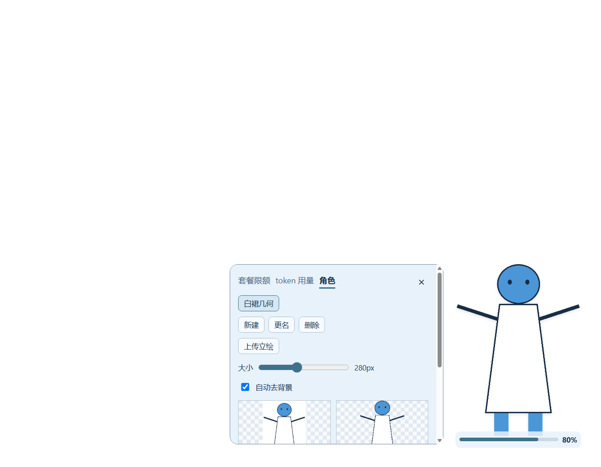
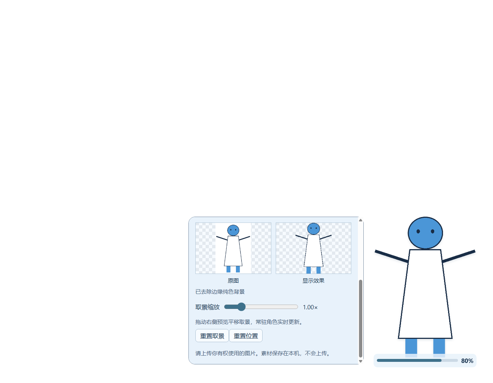
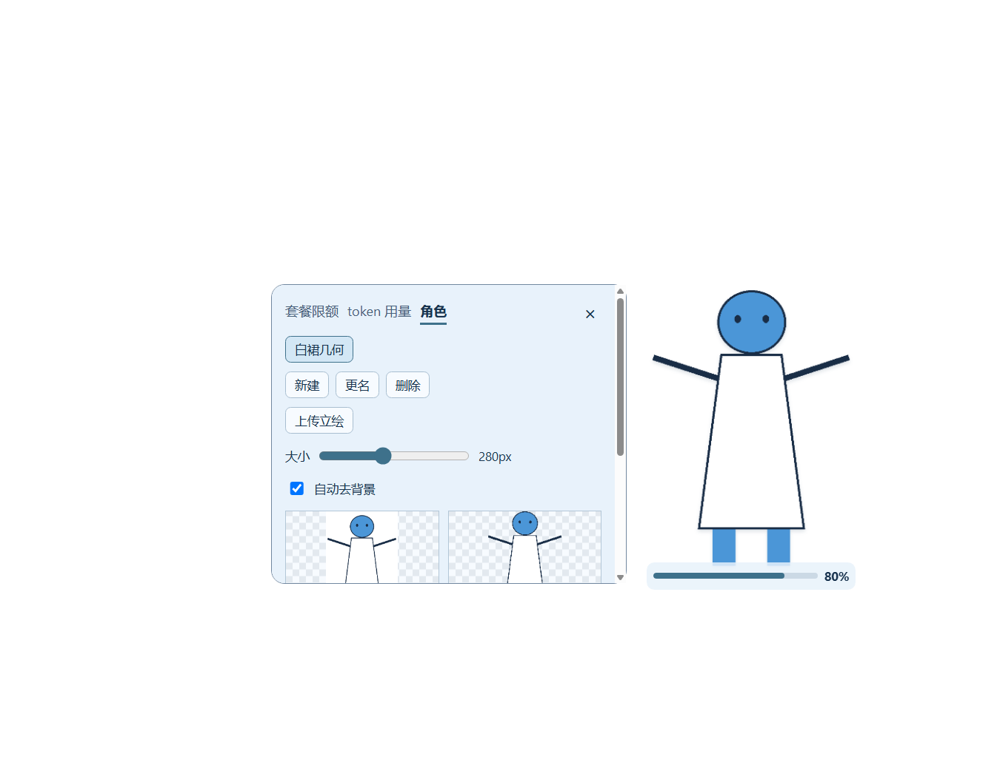

# 阶段 4b：单张立绘与点击反馈验收

2026-10-10，Windows，起点 f9f784a，原工作区干净。本轮使用桌面自带 Codex CLI 0.162.0-alpha.17.2 安装缓存；没有 push。所有效果截图使用本仓库 MIT 许可的白裙几何机器人 `tests/fixtures/portrait-white.png`，未复制用户动漫素材进仓库。

## 实现与迁移

`runtime/characters.cjs` 输出单个 `image` 描述。旧角色在读取时按 ready > tired > low > exhausted 选择第一张存在的图：先检查该档 settings.json 的合法文件名，再检查该档的 PNG/JPG/JPEG/WebP/GIF/BMP 文件。缺失的 ready 不会阻止 tired 被读取；没有任何可用图才显示占位。该过程不写文件，不改写旧 settings.json，不删除图片。

新上传通过唯一入口调用 `importPortrait`，仍按内容识别、10 MiB / 4096px 限制校验。副本命名为 `portrait-<随机标识>.<实际格式>`，settings.json 的 portrait 字段选择最新副本，优先于旧态图。每次上传使用新文件名，不覆盖旧 ready/tired/low/exhausted 或此前立绘；旧 images 与其他字段保留。保存大小、取景等参数也保留这些旧字段。原文件只读、不修改或移动；没有自动清理历史副本，保留文件是本次迁移约束。

原 `importFile` 与旧状态协议路径仅保留兼容旧数据及测试；产品上传入口不再调用四态导入，常驻与预览均只读取同一幅图。角色列表、新建/更名/删除/切换的既有操作保留；迁移和上传不自动删除角色，既有显式删除仍有确认对话框。

`character-view.js` 不再计算额度状态或降级滤镜。数字和细条继续表达额度；本次要求明确为 >20% 正常、>10% 且 ≤20% 橙、≤10% 红。旧实现红色阈值实际为 5%，本次只将展示阈值改为要求的 10%，未改额度数据读取与 token 统计。

## 点击反馈与形状边界

真实非拖动 pointerup 在现有 click/end 事件之前，给当前 canvas 添加 Web Animations 缩放：1 → 0.96 → 1，220ms、ease-out，原点 50%/60%。轻微收缩完全在既有矩形内部，不需要扩大区域。连续点击取消上一动画并重新播放；结束不保留 fill，计算样式恢复 none。没有新增图片或序列帧，也未向主进程发送新的动画布局/尺寸/形状消息。

**动画本身不改 region / shape。** 原有点击展开/收起本来会改变详情矩形，仍保留：测试点击前只有角色矩形，点击展开后增加详情矩形；在该正常布局完成后，动画期间和结束后的 region 完全一致，新增 setShape 调用为 0。不能把“点击展开的原有变化”误记成“动画改变形状”。

真实启动测试发现角色快照有时在监听器注册前到达，导致已有图停留在占位；将现有 ready 信号移到最后加载的 character-settings.js，在所有角色/额度/token 监听器注册完成后发送。未改主进程启动、焦点或几何逻辑。

## 逐项验收

| # | 标准 | 结果与证据 |
| --- | --- | --- |
| 1 | 一张图即可使用 | 通过。真实 Electron 单个上传按钮，经实际 preload/IPC 调用单图导入；只有一张文件的角色能解码和显示。 |
| 2 | 不随额度变化 | 通过。80/20/11/10/0% 下 URL、canvas 像素和 filter 完全相同；无额度窗口时仍为同一图，未换占位。 |
| 3 | 多态图迁移、不删除 | 通过。自动测试逐步加入 exhausted、low、tired、ready，选择随优先级变化，所有文件字节和读取前后 settings.json 不变。安装前对真实用户目录只读核验：7/7 文件 SHA256 不变，111.jpg 角色选择 ready.png；未复制用户图片到仓库。 |
| 4 | 仅 tired.png | 通过。真实 Electron 隔离角色仅有 tired.png、无 ready 文件，成功通过本机 portrait 协议解码；不是只验证元数据。缺失 ready 的旧映射也能回退到 tired。 |
| 5 | 无四态上传入口 | 通过。真实 DOM `.upload-character` 数量为 1，标签“上传立绘”；截图含唯一按钮。 |
| 6 | 数字与颜色阈值 | 通过。80% normal、20/11% orange、10/0% red，百分比文字与输入一致，额度服务代码未改。 |
| 7 | 当前图点击反馈 | 通过。真实鼠标 pointer 事件触发 canvas 动画，220ms、最小 scale 0.96，未加载第二幅图或新增素材。 |
| 8 | 动画不改形状，点击行为保留 | 通过。正常展开后期间/结束 region 一致，动画额外 setShape=0；实际 click 使计数加 1、expanded 翻转，现有收起逻辑保留。 |
| 9 | 克制且完全恢复 | 通过。采样变换 scale≈0.969604，结束 transform=none、动画数=0。用户完成所列操作检查后回复“可以探针”，未反馈异常；效果截图见下文。 |
| 10 | 拖动性能 | 通过。与 f9f784a 三轮配对，120 drag 回调位置/诊断写入均 0；边缘批次中位数 30.501→28.678ms，数据与口径见性能小节。 |
| 11 | 形状外宿主输入 | 通过。实机 24 个形状外点（含两块间隙）全部命中 Codex HWND919662；形状外滚轮转发数 1→1。用户按提示完成外部输入检查后回复“可以探针”。 |
| 12 | 异常回退 1×1 | 通过。10 组非法形状经真实 Electron/Win32 仍为 1×1 DIP；窗口144 DPI下形状为2×2物理像素。geometry.cjs 未改。 |
| 13 | 300ms 焦点 | 通过。实机 clicks 2→3；14ms 曾激活挂件，108ms 回到宿主，108/310/1010ms 三次采样均为宿主。切走测试没有被拉回。focusable:true 与 C#80ms方案未改。 |
| 14 | 既有设置 | 通过。真实UI大小180/280/420保存并生效，去底 false 与缩放1.3持久化；实际预览拖动保存 x≈0.289157/y≈0.212766。重置取景后返回1/0/0，重置位置为(676,396)，均经原按钮/IPC；角色面板实机滚动0→120且前台保持宿主。每角色参数持久化/切换另由既有角色及立绘测试覆盖。 |
| 15 | 默认位置 | 通过。真实隐藏 Electron 7例 fresh/saved/restart-saved/reset/restart-reset/small/corrupt 全通过；900×700、200×280默认(676,396)，已保存(120,140)重启沿用；100×80小视口缩至34×48并夹到(42,8)。main.cjs 与默认位置逻辑未改。 |
| 16 | 零消耗、本机图片 | 通过允许清单测试及代码审计。无新增网络/模型/子进程入口，CSP与本机协议约束不变；所有隐藏UI fixture替换账户reader/token Worker，不读取账户、不启动turn。本轮未重新做10分钟静置，不将此前观察冒充本轮证据。 |
| 17 | 占位截图 | 通过。四张真实Electron截图仅含自由分发几何机器人，见下文；透明背景在部分查看器显示黑色。 |

## 迁移实测细节

`single-character.test.cjs`：旧图文件只有 exhausted 时选 exhausted，添加 low 后选 low，再添加 tired 后选 tired，最后 ready 优先；每一步读取不改旧设置与图片字节。tired-only 带缺失 ready 映射、targetHeight=320 的旧配置读出 tired；保存 zoom=1.4 后，旧 images 与自定义 notes 仍保留。连续两次单图上传选择两个不同副本，旧图、前一副本与原文件均未被删除/修改；重启 store 后仍选择第二幅。

`single-character-ui.json` 初次加载 source 包含 `.../portrait?v=tired.png-...`，uploads=1，实际解码通过。大小、去底、取景保存后 metadata 仍含 `images:{tired:"tired.png"}`、`notes:"preserve legacy"`，新增 portrait 为唯一新副本。

安装前 `stage-4b-user-migration.json`：files=7、unchanged=true，111.jpg→ready.png。安装后再执行只读检查同样 unchanged=true；此时角色目录已有操作变化，不能把安装前7文件数量当成最终角色列表。两个报告均在用户数据目录，未将原图放入仓库。

## 性能实测与复现

```powershell
powershell.exe -NoProfile -ExecutionPolicy Bypass -File tests/Invoke-DragIoSmoke.ps1 -Baseline f9f784a -Runs 3
node tests/measure-drag-io.cjs C:\Users\Chester\.codex\codex-quota-widget\stage-4b-drag-comparison.json
```

历史主进程通过 git show 只读加载，HEAD 不动；真实隐藏 Electron、fs 和 setShape。两边均使用本次角色模块和空账户边界，测量差异集中于生产拖动路径，实际 main.cjs 与 f9f784a 字节相同。

| 120 drag 回调场景 | f9f784a 三轮 ms | 本次三轮 ms | 中位数 前→后 |
| --- | --- | --- | --- |
| 视口内首批次 | 45.692 / 54.492 / 47.903 | 36.782 / 36.844 / 31.741 | 47.903→36.782 |
| 边缘来回第二批次 | 30.501 / 31.654 / 28.074 | 25.279 / 31.410 / 28.678 | 30.501→28.678 |

每轮每个场景位置写入=0、诊断写入=0，end 后共2次写入。边缘仍为数十毫秒量级；不声称所有样本均20ms，也不将回调批次耗时等同于屏幕显示延迟。配对中位数未回退。

受控时钟检测120回调：写入/JSON序列化均0；6秒720事件仍是12次定时诊断、4次长拖动检查点、360次合并布局。定时器例外与上一修复相同；“0写盘”指拖动热回调，未取消长拖动兜底策略。该受控脚本默认对照更早的 bab3619；本轮性能对照以以上 f9f784a 实测为准。

实机10步拖动：(1384,575)→(1344,551)，position.json 同步一致，拖动没有误触点击；松手后的吸附及夹紧另由自动回归覆盖。完成探针后还原探针前位置（若没有后续用户位置变化），不覆盖用户测试中的主动调整。

## 测试命令与原始证据

```powershell
powershell.exe -NoProfile -ExecutionPolicy Bypass -File scripts/verify.ps1 -Native
powershell.exe -NoProfile -ExecutionPolicy Bypass -File tests/Invoke-SingleCharacterSmoke.ps1
powershell.exe -NoProfile -ExecutionPolicy Bypass -File tests/Invoke-CharacterFormatSmoke.ps1
powershell.exe -NoProfile -ExecutionPolicy Bypass -File tests/Invoke-PortraitSmoke.ps1
powershell.exe -NoProfile -ExecutionPolicy Bypass -File tests/Invoke-DefaultPositionSmoke.ps1
node tests/inspect-character-migration.cjs C:\Users\Chester\.codex\codex-quota-widget\characters C:\Users\Chester\.codex\codex-quota-widget\stage-4b-user-migration.json
powershell.exe -NoProfile -ExecutionPolicy Bypass -File tests/Invoke-MouseProbe.ps1 -Label stage-4b -RequirePass -VerifySwitchAway -ExpandDetails
powershell.exe -NoProfile -ExecutionPolicy Bypass -File tests/Invoke-WheelProbe.ps1 -Label stage-4b -RequirePass
```

最终自动测试59/59通过；真实形状非法输入10例、默认位置7例、单图实际renderer/IPC、格式导入和白裙裁剪/极端比例回归通过。新增迁移与单图测试先在旧实现失败，再实现后通过；真实首次加载测试曾复现启动快照时序问题，监听器就绪修复后通过。

原始证据存放于 `C:\Users\Chester\.codex\codex-quota-widget`：

- `stage-4b-ui/single-character-ui.json`（单图、五档颜色、动画、设置）；
- `stage-4b-user-migration.json` / `stage-4b-user-migration-final.json`（只读哈希）；
- `drag-io-native/f9f784a-run-{1,2,3}/{before,after}.json` / `stage-4b-drag-comparison.json`；
- `mouse-probe-stage-4b.json` / `wheel-probe-stage-4b.json`；
- `default-position-native/*.json` / `shape-smoke.json`。

## 效果截图

常驻态、唯一上传入口及大小设置：



取景、重置位置与本机素材声明：



点击前常驻态：


点击缩放反馈期间，同时保留原有展开行为：



## 缓存与只读审查

最终 stop→使用桌面0.162.0-alpha.17.2 plugin add→逐文件SHA256→缓存start；99/99发布文件SHA256一致，缓存无额外发布文件，结果见 `stage-4b-cache-hashes.json`，不计缓存 .git 元数据。最终安装包含本轮文档、测试及截图；还原受控探针前的位置，保留用户测试中的角色操作结果。

按 review skill 的独立只读审查清单检查 f9f784a 到工作区变更：读取迁移无写入、新上传不覆盖旧文件、元数据保留、链接/路径/文件大小约束仍有效；单图与额度解耦、动画不进IPC形状路径、ready在监听器就绪后发送。main.cjs、geometry.cjs、WindowApi.cs、额度/统计/允许清单与网络边界均未改；没有发现阻塞问题。既有系统DPI96但窗口报告144的待观察项沿用，不在本轮修改。
