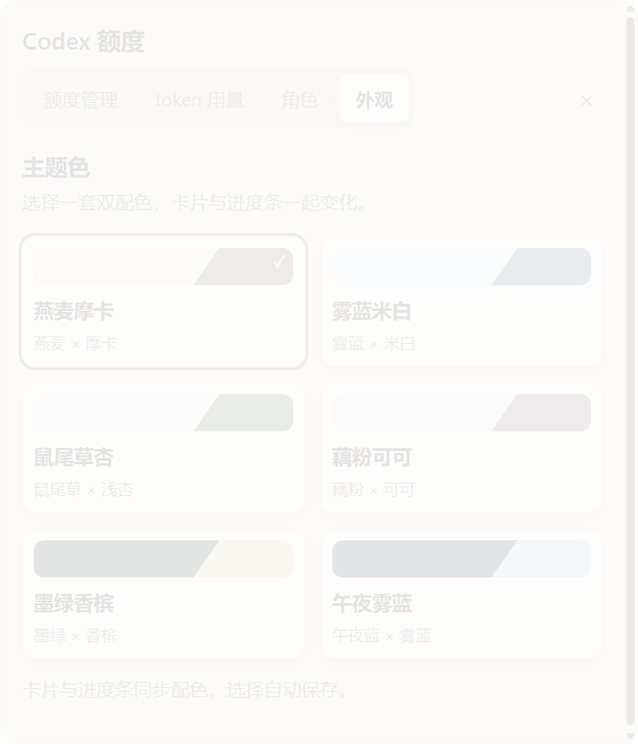
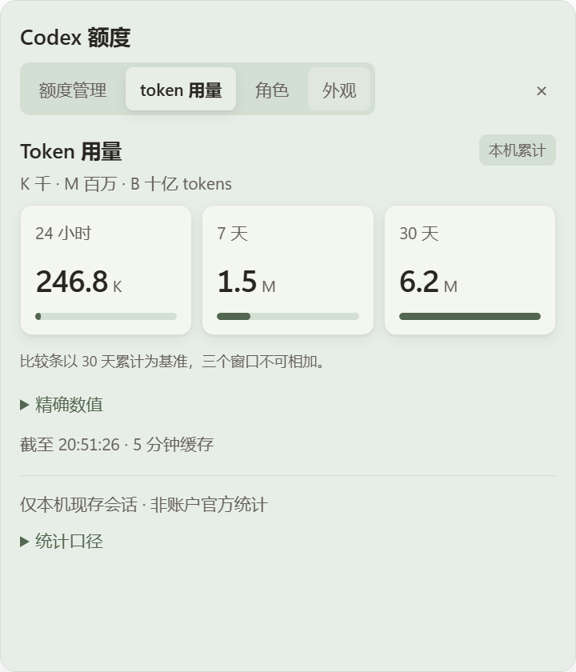
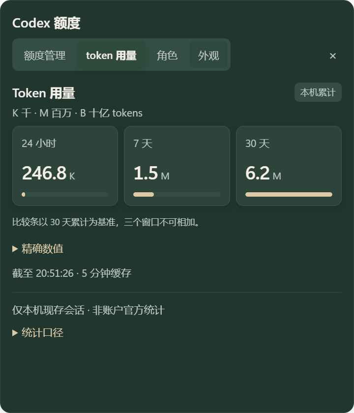

# 外观追加：六套双配色

2026-10-10，基线 0b75580。按用户最新要求，主题色同时决定卡片颜色，移除显示模式、独立卡片底色与自定义取色器。仅修改外观及其验证，不重做 token、角色、窗口或数据读取功能；未 push。

## 配色参考与结果

查阅 [Pantone 官方巴西站的 Mocha Mousse 配色说明](https://www.pantone.com.br/artigos/cor-do-ano/paletas-de-cores-pantone-17-1230-mocha-mousse/)：Relaxed Elegance 通过米色、奶油色、灰与棕建立层次，Subtle Contrasts 搭配棕色与蓝灰。参考其少量主色和克制对比的思路，以下颜色由本插件自行选择，不是 Pantone 标准色值。没有安装其他软件或下载素材。

| 主题 | 卡片基色 | 强调色 | 六类文字配对最低对比度 |
| --- | --- | --- | --- |
| 燕麦摩卡（默认） | #eee5d8 | #776150 | 4.5532:1 |
| 雾蓝米白 | #e4ecf1 | #4a657b | 4.5126:1 |
| 鼠尾草杏 | #e7eee7 | #526650 | 4.5071:1 |
| 藕粉可可 | #efe3e4 | #825d68 | 4.5226:1 |
| 墨绿香槟 | #20362f | #ddcba8 | 4.5461:1 |
| 午夜雾蓝 | #222d42 | #b7cadb | 4.5466:1 |

卡片使用同色系的基底、抬升和凹陷层次；按钮、选中框、正常额度条与 token 比较条使用配套强调色。额度橙/红阈值仍保留。双色斜分仅用于选择按钮预览，正文卡片保持清晰的单色表面。每套固定自己的明暗层次，系统明暗变化不会改变所选配色。

## 设置与迁移

- appearance-model.js 定义六套配色和严格的 `{palette}` 校验；文字根据所有表面自动校准到至少 4.5:1，包含常驻半透明底衬叠在纯黑/纯白背景的情况。
- appearance-settings.js 只生成六个双色选择按钮。实时更新 CSS 变量，150ms 合并异步保存；不调用形状、布局、位置或数据采集。
- AppearanceStore 读取旧版 `{mode,accent,surface}` 时映射到接近的新主题。绿色映射鼠尾草杏，蓝色映射雾蓝米白，粉紫映射藕粉可可，其余浅色映射燕麦摩卡；旧深色按强调色映射墨绿香槟或午夜雾蓝。旧跟随系统设置迁移为固定主题。
- 读取迁移只返回新设置，不写文件、不修改旧对象。用户实际选择后才以新格式保存。旧绿色 `#248a3d` / 米白实测映射到 `sage`，原文件字节不变。
- 保留已有本机 IPC 的 sender 校验、固定路径、异步原子保存、坏文件/超大文件默认回退和符号链接拒绝；未动用户角色或位置文件。

## 验证与证据

新增 palette.test.cjs 时旧实现因缺少单配色模型与迁移而失败；实现后通过。scripts/verify.ps1 -Native：70/70 单元测试通过；10 例真实 Electron 异常形状仍回退 1×1 DIP（本机窗口 144 DPI 时 2×2 物理像素）。既有拖动零写盘、默认位置、角色迁移和只读允许清单回归通过。

Invoke-AppearanceSmoke.ps1 使用生产 main、隔离数据目录与本项目几何占位图，逐一实际点击六个主题：卡片/子卡片/按钮 CSS 颜色正确，六套最低文字对比度 4.507145185:1。系统从浅切深后各套颜色都未变化。无旧显示模式/底色/取色器控件；选中和焦点环正常（2px）。外来窗口读返回 null、保存被拒绝。六次配色选择额外 setShape 调用为 0，region 保持角色 200×280 和面板 480×560。

再启动一个独立 Electron 进程，读取到已保存的 `{palette:"forest"}`，页面恢复墨绿香槟。Invoke-PopupSmoke.ps1 同样通过：一个窗口、一次点击展开、四个页签、480×560 面板，token 概览与精确值正确；480×320、200×180 小视口下 token 无水平溢出。配色操作额外 setShape=0。

原始证据保存在运行时目录 stage-5a-ui/appearance-ui.json、stage-5a-ui/restart.json、stage-5a-popup/popup-ui.json。测试未使用用户角色素材，没有注入用户鼠标。main.cjs、geometry.cjs、WindowApi.cs、preload、拖动/位置与额度/token读取未修改；本次不重复十分钟静置。焦点和卡片外宿主输入继续沿用之前待实机探针状态，本记录不把未做的项目标为通过。

## 效果图

以下使用隔离的几何占位素材与固定示例数字，不含用户图片。

## 安装

已执行 stop。Codex CLI 0.162.0-alpha.17.2 的 plugin add 返回 `failed to back up plugin cache entry: 拒绝访问。(os error 5)`，因此沿用上一轮缓存更新方式：修改前逐文件备份差异，再同步到既有 0.1.0 安装缓存。最终 136/136 文件 SHA256 一致，没有额外插件文件（不计 .git 元数据），然后从缓存 start 成功。哈希清单为运行时 stage-5a-palettes-cache-hashes.json，差异备份也在运行时目录；未修改插件注册。用户旧绿色/米白设置仍保持原格式，实际读取结果为 `{palette:"sage"}`。

本轮没有新增网络请求、图片上传、依赖或 agent turn。
