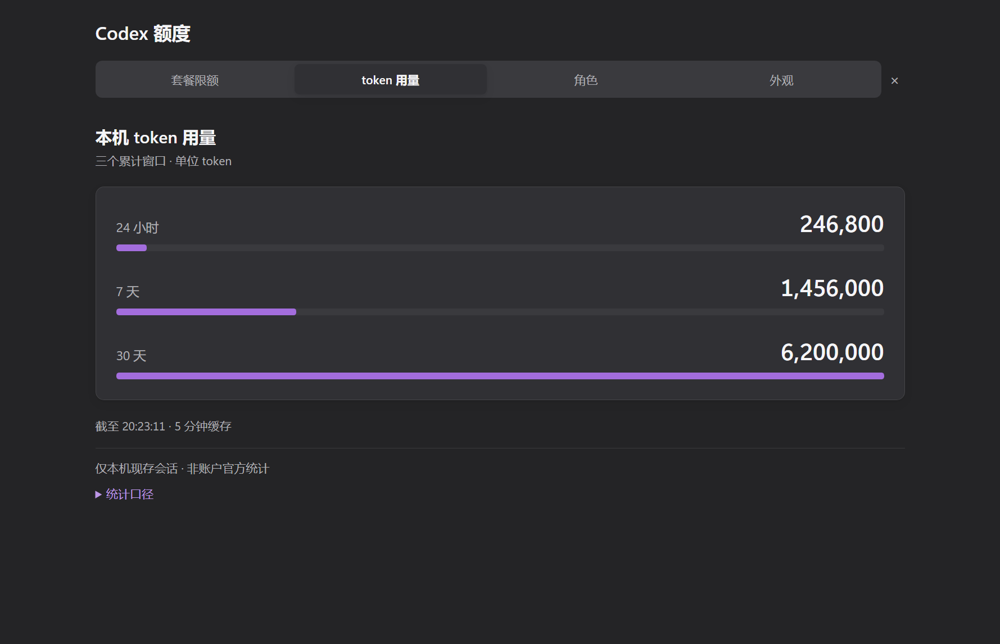
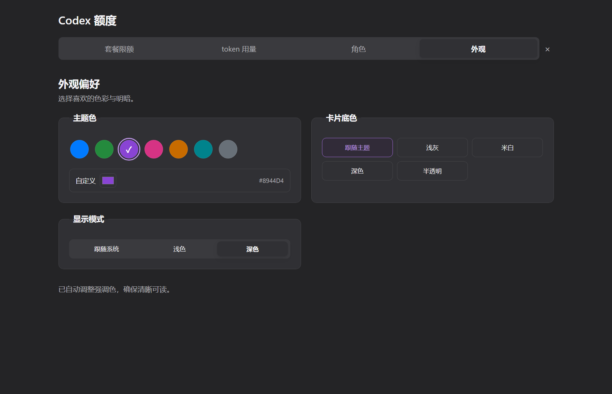
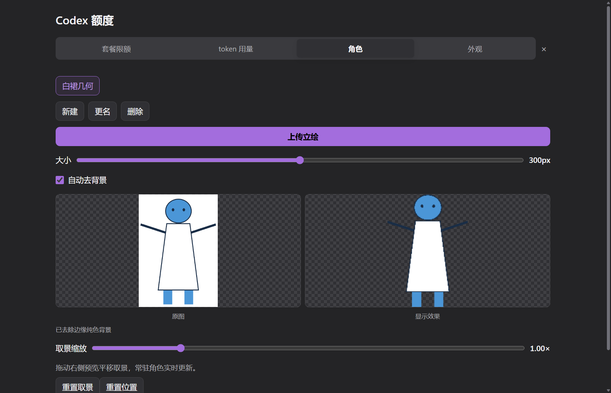

# 阶段5a追加：图表可读性与放大设置窗口

2026-10-10，基线6c7e06f。用户反馈token竖柱难看、320×352设置面板太挤，要求放大并保留关键信息。本次增加由用户主动打开的普通可缩放窗口；常驻挂件继续沿用既有透明形状、拖动、焦点恢复和右下角位置。未push。

## 参考与取舍

只查阅项目作者的说明，没有安装或运行其他额度工具、复制代码或下载素材：

- [CodexBar UI说明](https://github.com/steipete/CodexBar/blob/main/docs/ui.md)：独立设置、清晰的用量选择器与数字检查区，窄窗口避免挤压标题。
- [Codex Monitor](https://github.com/manuelsh/codex-monitor)：剩余额度、重置时间和用量数字为主要信息，更多信息展开查看。
- [Codex Usage Counter](https://github.com/remriel/codex-usage-counter)：常驻额度展示与大幅统计视图分开，统计支持全屏。
- [Codex Token Dashboard](https://github.com/Jack-Tsue/codex-token-dashboard)：趋势、热力图与项目分析适合完整dashboard。本阶段只有三个滚动累计窗口，未虚构每日趋势或新增历史采集。

采用“小面板看关键数值，大窗口调整与查看”的方式；三条横向柱分别显示24小时/7天/30天累计值，共用30天比例尺。24小时包含在7天、7天包含在30天，不能相加，口径说明保留。显示原始千分位数字，不用缩略值替代精确值。

## 改动与操作

点击角色展开后，在顶部点击“放大 ↗”。默认窗口840×680，最小540×520；可拖动边框、使用Windows最大化按钮，打开时沿用当前页签。四个页签共用原来的本机快照、角色和外观设置，重复打开会复用已有窗口。关大窗口不关常驻挂件。

大窗口正文15px，说明14px，token数字28px；宽窗口的外观设置以两列排列，窄窗口恢复单列，色板可换行。角色原图/效果预览增至220px高，滑杆随窗口宽度拉伸，设置控件可键盘聚焦。

小面板的竖柱改为三行“时段 / 精确数字 / 横向柱”，数字和柱分离，避免文字压在短柱上。统计口径、索引文件数、完整共享池说明收进可展开说明；索引中/部分覆盖提示仍留在默认页面，未把不完整数据伪装为完整数据。

实现需要扩展主进程的本机窗口与IPC路由，这是用户后续“设置能放大”的需求带来的范围调整。新增workspace.cjs仅创建普通窗口；geometry.cjs、WindowApi.cs、runtime额度/token/MCP/角色后端/取景算法均未改。普通设置窗口是用户主动打开并操作的窗口，可以正常取得焦点；常驻挂件仍由原有C#80ms方案恢复Codex焦点。设置窗口不使用setShape，不修改常驻矩形和拖动分支。

新增IPC只接纳常驻窗口与当前设置窗口的webContents；任何其他窗口都不能读取/写外观或操作角色。窗口加载固定本机文件，禁外部导航/弹出页，contextIsolation与sandbox打开、nodeIntegration关闭。使用同一存储队列与同一角色操作队列，不重复采集额度或创建第二个token Worker；设置窗口变化会广播回常驻界面。原有图片导入仍复制到本机，文件对话框隶属当前发起操作的窗口。

## 本轮报错与修复

用户提供的主进程报错为源码desktop/main.cjs:173的“Object has been destroyed”。实测进程28488命令行是本轮workspace-ui-smoke隐藏测试，不是缓存中运行的正式挂件29828。

测试暂停模拟心跳统计主题形状，随后更多截图/尺寸检查超过3.5秒宿主超时，触发退出。退出后到达的管道包仍进入sync，异常处理再对已销毁窗口调用hide，造成第二个未捕获异常。已停止这个测试进程。

生产修复：before-quit标记quitting，sync/管道入口跳过退出或销毁状态，catch仅隐藏存活窗口，超时定时器不再访问销毁窗口。未改变认证、形状校验、焦点恢复或数据采集。测试恢复主题采样后的模拟心跳，并保持全部fixture窗口隐藏。新增shutdown.test在旧实现实测失败，修复后通过；覆盖合法认证的延迟管道包与退出后定时器。

## 自动与原生窗口验证

| 项目 | 本轮实测 |
| --- | --- |
| 自动测试 | 64/64通过，含窗口销毁回归、允许清单、拖动、默认位置、角色迁移与内容检测。 |
| 设置放大 | 540×520、840×680、1200×800实际窗口分别为526×484、826×644、1186×764网页客户区，无水平溢出。窗口resizable/maximizable均开启。 |
| 外观布局 | 三档窗口大小下所有设置分组均无横向溢出；大窗口正文15px。 |
| 图表 | 几何fixture精确返回246,800 / 1,456,000 / 6,200,000；横柱宽度按比例递增，标签与数字不重叠。 |
| 小面板 | 320×214/270/352三档通过横柱、同色、索引状态、说明可滚动至可见的原生测试。 |
| 同步 | 大窗口改紫色/深色后常驻界面同步；修改角色高度到300后常驻大小控件同步。 |
| 权限 | 第三个非授权窗口的appearance-read为null、appearance-save和character-action均ok:false。 |
| 形状独立 | 调大设置窗口前后常驻region相同；设置配色期间额外setShape=0。 |
| 生命周期 | 重复打开仍仅两个窗口；关闭设置窗口后常驻窗口未销毁；退出竞态回归通过。 |
| 颜色 | 70组配色重跑通过，最低正文4.500353580:1、强调文字4.500693575:1，主题额外setShape=0。 |
| 角色回归 | 单图、220ms反馈、形状0额外调用、180/280/420大小、去背景、缩放平移、重置均通过；纵向/白裙/极端比例和滚轮测试通过。 |
| 异常形状 | 10例仍回退1×1 DIP；本机144DPI窗口对应2×2物理像素。 |
| 焦点/形状外输入 | C#与geometry未变，实机SendInput及用户体验仍待本轮鼠标暂停后复测；没有把之前的回复当成本轮通过证据。 |
| 零消耗/本机图片 | 允许清单测试通过，新增仅本机窗口/IPC；未新增网络资源、图片上传、agent turn，未重复10分钟静置。 |

### 拖动写盘与耗时

```powershell
powershell.exe -NoProfile -ExecutionPolicy Bypass -File tests/Invoke-DragIoSmoke.ps1 -Baseline 6c7e06f -Runs 3
```

真实隐藏Electron、120事件/批次；每轮位置与诊断写盘均0，end后合计2次。未新增热路径序列化或窗口广播。

| 批次 | 前三轮ms | 后三轮ms | 中位 前→后 |
| --- | --- | --- | --- |
| 视口内 | 27.319 / 48.740 / 25.649 | 24.255 / 43.726 / 56.097 | 27.319→43.726 |
| 边缘来回 | 22.083 / 21.885 / 22.202 | 22.330 / 20.427 / 21.393 | 22.083→21.393 |

边缘批次仍约20ms；第一批存在启动/系统调度波动，不将批次耗时当逐帧视觉延迟，也不声称所有耗时下降。拖动生产分支未变。

复现：scripts/verify.ps1 -Native；tests/Invoke-WorkspaceSmoke.ps1；tests/Invoke-AppearanceSmoke.ps1；tests/Invoke-PortraitSmoke.ps1；tests/Invoke-SingleCharacterSmoke.ps1。原始证据均在运行时数据目录stage-5a-workspace/、stage-5a-token-refresh/、stage-5a-ui/及drag-io-native/6c7e06f-run-{1,2,3}/，未提交用户数据。

## 效果图

截图由真实Electron窗口捕获，示例数字与白裙几何机器人为隔离测试数据，无用户动漫素材。改造前竖柱见[上轮截图](images/stage-5a-after-dark-token.png)。







## 安装与审查

stop→桌面CLI0.162.0-alpha.17.2重装→逐文件SHA256→缓存start；125/125文件一致，无多余文件，逐文件清单见运行时stage-5a-readability-cache-hashes.json。用户角色、外观和位置文件保留。单独只读审查了本机窗口路由、sender校验、设置同步、生命周期和拖动分支；没有新增账户读取能力或外部资源。
