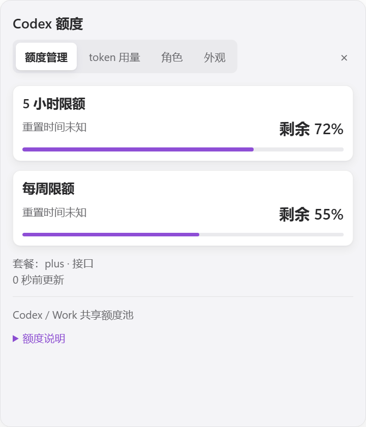
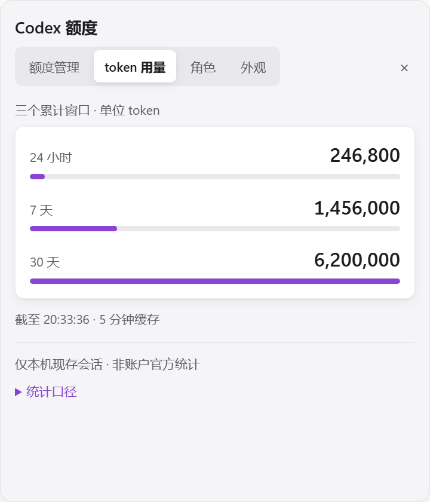
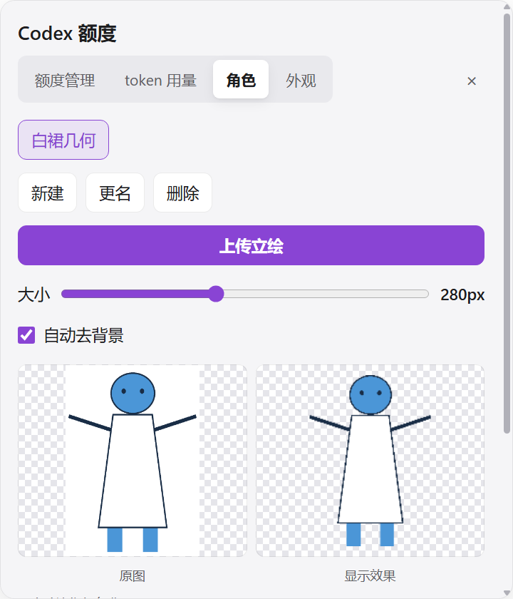
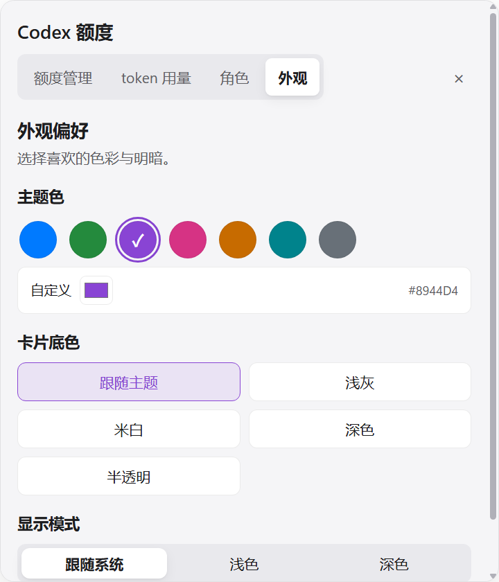

# 阶段5a追加：单击展开大卡片与横向用量图

2026-10-10。用户最终明确：不要“放大”按钮或独立设置窗口，只将点击角色后出现的卡片放大。此记录覆盖6abd6a2的独立窗口方案；该方案已撤回。未push。

## 交互与可读性

点击角色一次，直接展开480×560 DIP卡片，四个页签为额度管理、token用量、角色、外观；再次点击或关闭按钮收起。只有原来的一个透明挂件窗口，不增加窗口、采集器、Worker或跨窗口广播。去掉独立窗口模块、按钮和相关IPC，恢复单窗口的sender校验。

卡片正文15px，说明14px、标题17px、token数字22px；色板36px，角色预览180px，大小及取景滑杆占据可用宽度。角色和外观页内容可纵向滚动。常驻立绘尺寸、点击反馈、数据读取和大小设置保持原有逻辑。

token使用三行横向柱：24小时、7天、30天，按30天值归一化，独立显示精确千分位数字。累计窗口不能相加；本机统计与共享池的关键声明常显，完整口径/索引数收进“统计口径”“额度说明”。索引中、部分覆盖仍常显。

## 参考

只阅读项目作者的文档，未安装其他工具、复制其代码或下载素材：

- [CodexBar](https://github.com/steipete/CodexBar/blob/main/docs/ui.md)：用量数字与设置层级清晰。
- [Codex Monitor](https://github.com/manuelsh/codex-monitor)：剩余额度、重置时间和关键数字优先，其余按需展开。
- [Codex Usage Counter](https://github.com/remriel/codex-usage-counter)：常驻信息与统计视图分层。
- [Codex Token Dashboard](https://github.com/Jack-Tsue/codex-token-dashboard)：完整趋势/热力图适合dashboard。本插件只有三个累计窗口，不虚构每日趋势。

采用关键数字优先和可展开说明；按用户最终要求全部放在单击展开的卡片里。

## 几何安全边界

PANEL由320×352改为480×560，固定卡片高度不再随额度窗口数量变化，避免未知/单窗口数据下设置区过小。实际尺寸仍受视口减去24px边距与8px起点约束。角色上限672×420未变；面板全局上限500×560，合计全局面积预算562,240 DIP²。

只调整尺寸常量与面板高度分配，未放松整数、坐标、逐矩形实际尺寸预算、64矩形上限、全局面积预算、保留外侧滚动条或异常回退1×1校验。角色拖动、吸附、默认右下角、位置写盘与C#80ms焦点恢复方案未改。扩大详情矩形属于本轮刻意调整，配色与点击反馈动画自身均不改变形状。

## “Object has been destroyed”修复

用户截图指向源码desktop/main.cjs:173。实测进程28488来自本轮隐藏UI测试。暂停模拟宿主心跳后超时退出，随后到达的管道包仍访问已销毁窗口，异常处理再次hide产生未捕获异常。

保留修复：before-quit设置quitting；sync与管道入口跳过退出或销毁状态，catch仅隐藏存活窗口，超时定时器避免访问已销毁窗口。认证和数据允许清单保持原状。shutdown.test在修复前失败、修复后通过，覆盖已认证延迟包和退出后的定时器；fixture主题采样后恢复心跳。

## 本轮验证

| 项目 | 实测证据 |
| --- | --- |
| 自动检查 | scripts/verify.ps1 -Native：66/66通过，包含新增大卡片与退出竞态回归。 |
| 单击/四页签 | 原生Electron生产main，点击一次clicks=1、expanded=true、窗口数=1；四页签均480×560、正文15px、没有横向溢出或放大按钮。 |
| 小视口 | 480×320时详情448×288；200×180时168×148；恢复900×700后480×560。所有region均在保留边界内，超限profile/整窗形状失败关闭。 |
| 横向图 | 隔离示例准确显示246,800 / 1,456,000 / 6,200,000；原生token Worker扫描26MB，主线程最大心跳间隔21ms。480×448受限视口下0/1/2额度窗口、三种索引状态、同色比例与说明可见均通过。 |
| 颜色 | 70组系统/手动/底色/强调色通过，最低正文4.500353580:1、强调文字4.500693575:1。主题额外setShape=0。 |
| 角色 | 单图迁移、220ms反馈结束还原、动画额外setShape=0、180/280/420大小、背景/取景/重置通过。白裙内白色保留，超宽/窄图正常。 |
| 滚轮 | 隐藏原生角色面板scrollTop=0→120，最大可滚动202，document.hasFocus=false。测试按实际滚动范围断言，等待绘制提交后注入。 |
| 异常形状 | 10例回退1×1 DIP；本机窗口144DPI时对应2×2物理像素。 |
| 拖动 | 下表3轮真实main测量，移动写盘均0，松手合计2次；拖动期间UI重绘次数0。 |
| 焦点/形状外宿主输入 | 待本轮用户暂停鼠标后实机探针；不把上一版独立窗口测试或此前回复当通过证据。 |
| 零消耗/本机图片 | 允许清单测试通过，未新增网络资源、图片上传、agent turn；未重复10分钟静置。 |

### 拖动性能

复现：powershell.exe -NoProfile -ExecutionPolicy Bypass -File tests/Invoke-DragIoSmoke.ps1 -Baseline 6c7e06f -Runs 3。

每批120事件，三轮移动期间positionWrites=0、diagnosticWrites=0，end后合计2次。数值是批处理耗时，不是单帧视觉延迟。

| 批次 | 基线3轮ms | 当前3轮ms | 中位数前→后 |
| --- | --- | --- | --- |
| 视口内 | 48.548 / 37.322 / 30.792 | 28.304 / 43.886 / 30.640 | 37.322→30.640 |
| 边缘来回 | 22.059 / 20.926 / 33.705 | 21.921 / 21.988 / 22.288 | 22.059→21.988 |

基线为阶段5a首版6c7e06f。原始数据位于运行时drag-io-native/6c7e06f-run-{1,2,3}/，不提交用户运行数据。

其他复现入口：tests/Invoke-PopupSmoke.ps1、Invoke-AppearanceSmoke.ps1、Invoke-PortraitSmoke.ps1、Invoke-SingleCharacterSmoke.ps1；token原生脚本tests/token-ui-smoke.cjs。隔离测试报告位于stage-5a-popup/、stage-5a-ui/、stage-4a-ui/、stage-5a-token-refresh/。

## 效果图

真实Electron捕获，示例额度/token和可自由分发的白裙几何机器人；未使用用户动漫素材。

## 安装与交付

采用stop→桌面CLI0.162.0-alpha.17.2重装→源码/缓存逐文件SHA256→缓存start。本轮126/126个源码文件SHA256一致，无额外插件文件（不计安装复制的.git元数据），逐文件清单见运行时stage-5a-popup-cache-hashes.json。实机焦点/形状外输入仍待用户暂停鼠标后复测，未标成通过。用户角色、外观和位置文件保留。未push。
