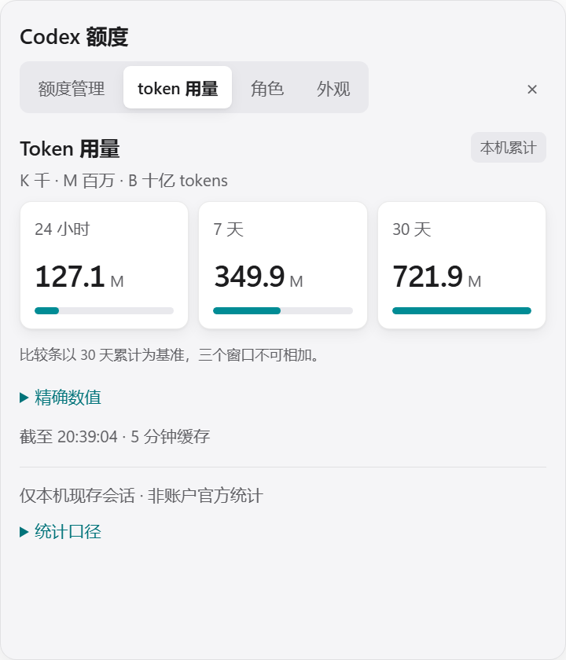
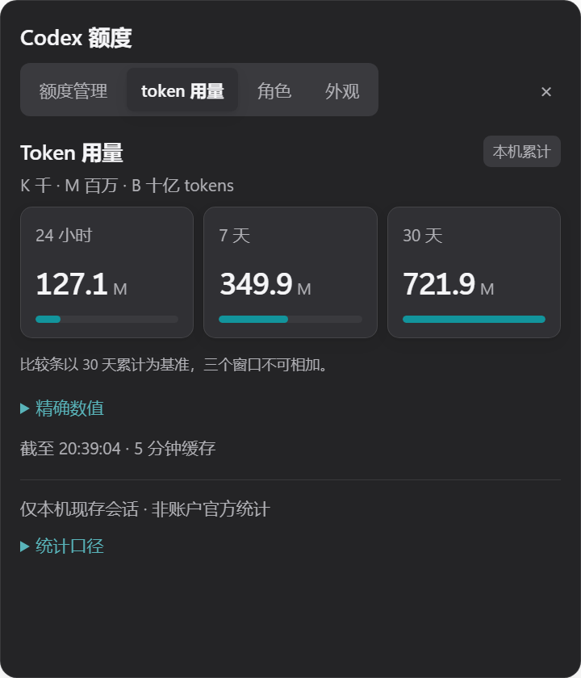
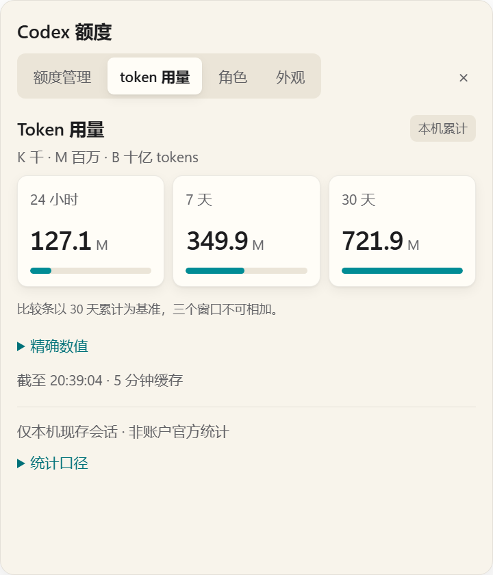

# Token展示追加：短数值与指标卡

2026-10-10，基线e8f7c14。用户认为127,082,579等长串数字难看，要求参考其他Codex额度工具。本轮仅调整token展示，保持单击展开480×560四页签卡片。未push。

## 调研与采用

查阅作者的一手说明，未安装或运行其他工具，未下载素材：

- [Codex Token Monitor](https://github.com/gouwenct/Codex-Token-Monitor)：状态栏用56k、54.6k等简短值，点击进入详细dashboard。采用短数值作为概览、完整数字按需查看的层级。
- [CodexBar UI说明](https://github.com/steipete/CodexBar/blob/main/docs/ui.md)：概览与详细检查分层，统计图有数值检查区，未知、不完整、零值分别表达。沿用本机范围声明和索引状态。
- [Codex Usage Dashboard](https://github.com/luyh7/codex-usage-dashboard)：紧凑列表配合详细token拆分与悬停信息。
- [Codex Token Dashboard](https://github.com/Jack-Tsue/codex-token-dashboard)：趋势与日历适合全尺寸dashboard。本轮只有三个累计窗口，不虚构每日趋势，也不改变采集。

三张指标卡为本插件自己的布局选择，并非声称照搬上述项目界面或代码。

## 改动

- view-model.js保留原始千分位text与原始比较比例，新增短数值number/unit。K=千、M=百万、B=十亿；缩写保留一位小数，舍入到1000时进到下一单位，避免1000.0K。零为0，未知/非法值为破折号，不伪装为零。
- renderer.js把时段、26px半粗数字、13px弱化单位、细比较条放进三张指标卡。悬停和读屏描述提供精确值；可展开的“精确数值”表格保留完整整数，可选中文字。
- index.html加入Token用量标题、本机累计标识、单位说明及精确数值入口。覆盖不完整提示仍常显；累计窗口不可相加仍常显。
- style.css使用原有变量、主题与阴影，所有颜色继续走变量。卡片内容宽度不足380px时通过容器查询切到单列行式展示；超长极端数值降低字号。没有网络字体、图片或新增依赖。

本轮没有修改geometry.cjs、main.cjs、WindowApi.cs、preload、额度/token读取、角色、位置或拖动逻辑；仍只有一个窗口。完整原始统计值和比较比例未舍入，只有概览数字舍入。

## 验证

先新增token-format.test.cjs，旧版本因number/unit缺失而2项失败；实现后通过。覆盖用户截图三项数值、单位进位边界、MAX_SAFE_INTEGER、零/未知/非法数值。

scripts/verify.ps1 -Native：68/68通过；10例异常形状仍回退1×1 DIP（本机窗口144DPI时2×2物理像素）。既有拖动0写盘、默认位置、迁移、允许清单回归通过。

Invoke-PopupSmoke.ps1：真实Electron生产main，隔离几何素材与固定示例数据。三种背景分别测得：

| 时段 | 概览数字 | 单位 | 精确值 |
| --- | --- | --- | --- |
| 24小时 | 127.1 | M | 127,082,579 |
| 7天 | 349.9 | M | 349,858,297 |
| 30天 | 721.9 | M | 721,904,248 |

浅色/深色/米白的卡片均无水平溢出；“精确数值”展开可见、user-select:text。480×560四页签保持，窗口数1；主题额外setShape=0。480×320及200×180视口下token内容无水平溢出，region均受既有边界约束。这里检查的是token内容；极小视口下原有四页签标题的宽度不属于本次改动。

Invoke-AppearanceSmoke.ps1：70组配色通过，最低正文4.500353580:1、强调文字4.500693575:1，主题额外setShape=0。

原始证据：运行时stage-5a-popup/popup-ui.json、stage-5a-ui/appearance-ui.json；未将用户运行数据或角色原图提交到仓库。三个截图使用隔离的固定数字，没有用户角色素材。

### 效果图

## 安装与范围

已停止挂件。CLI两次plugin add都返回“failed to back up plugin cache entry: 拒绝访问(os error 5)”，未盲目结束MCP或Codex进程。按实际131个源码文件同步到既有0.1.0缓存，修改前保留缓存差异备份，然后逐文件核对SHA256并从缓存start；未改插件注册或运行时用户设置。最终131/131一致，无额外插件文件（不计.git元数据）。哈希清单：运行时stage-5a-token-cache-hashes.json。未新增网络路径、图片上传或agent turn，也未重复10分钟静置。焦点/卡片外宿主输入维持上一记录的待实机探针状态，本轮没有注入用户鼠标。
