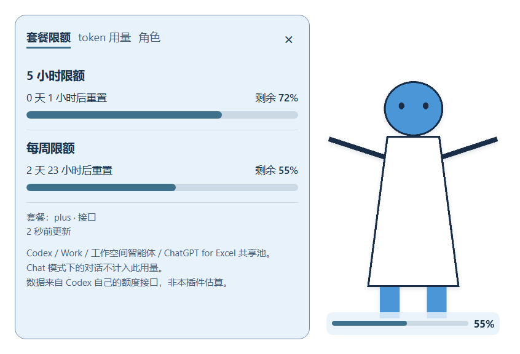
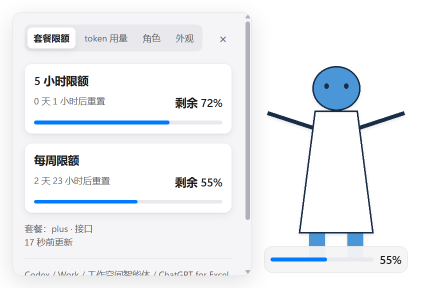
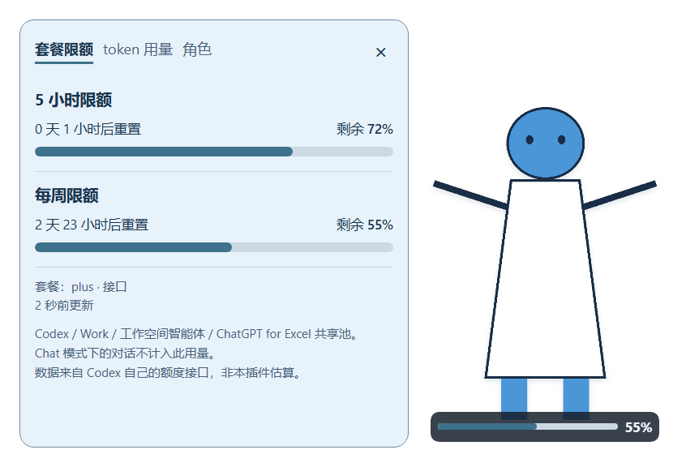
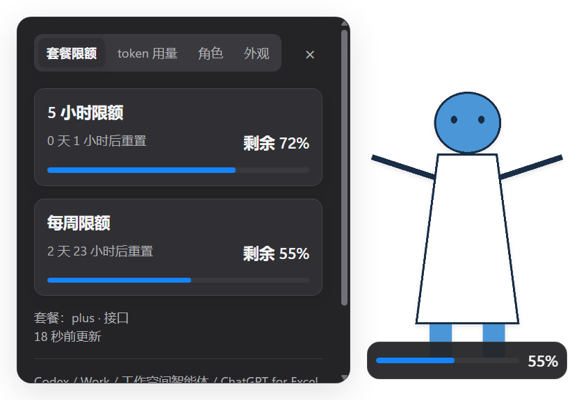
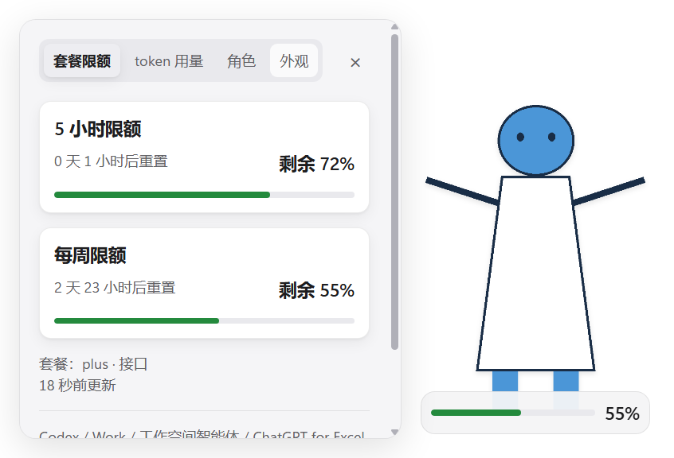
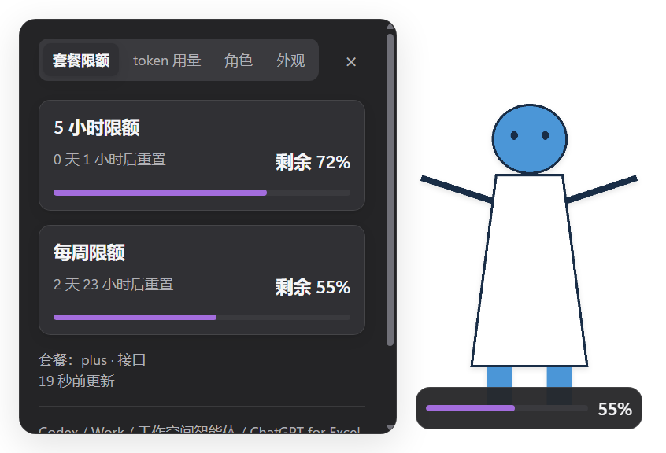
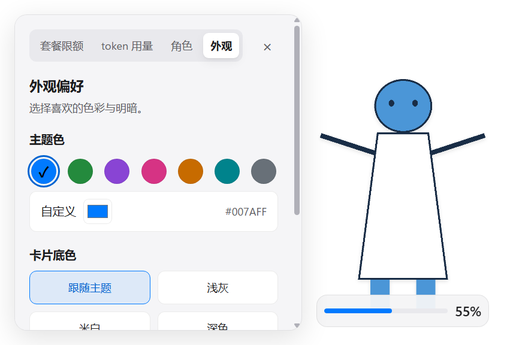
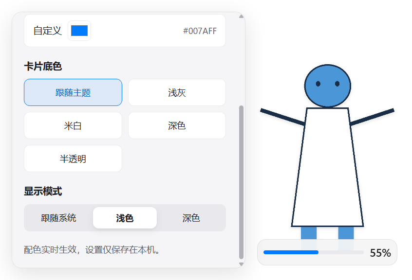
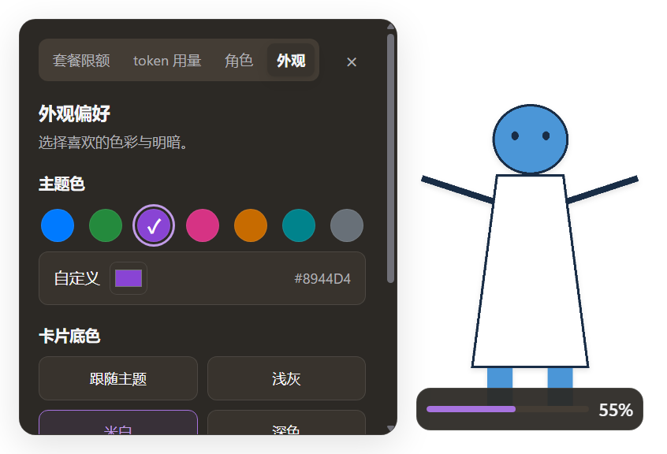
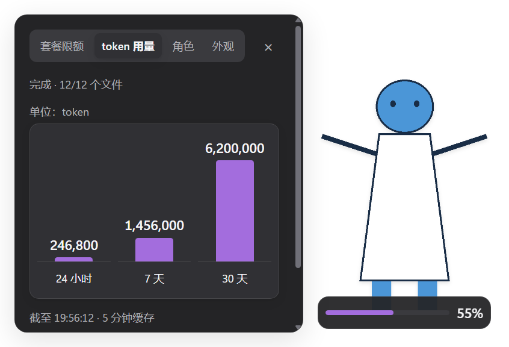

# 阶段 5a：设计系统与可自定义配色验收

后续用户反馈的图表可读性、单击展开的大卡片与退出报错，另见[追加验收记录](stage-5a-readability-verification.md)。下文保留6c7e06f首次交付的历史实测范围与待验状态。

2026-10-10，Windows，起点9f6a1b6，原工作区干净。只调整视觉和新增外观设置；未 push。效果图为本仓库 MIT 许可白裙几何机器人与隔离的额度/token示例数据，未复制用户角色素材。

## 范围与设计变量

style.css 整体改为变量驱动。字体使用指定系统栈，不加载或打包字体；实际 Electron 计算样式包含 Segoe UI 等完整字体栈，正文13px。标题15px/600、次要文字12px、数字15px/600，tabular-nums。面板16px内边距、4/8/12/16/20/24间距刻度，层级圆角12/14/10/8/6/3，细边和低透明度扩散阴影。面板只做240ms透明度显现，不移动区域；新控件使用150ms悬停、200ms cubic-bezier(.32,.72,0,1)过渡。既有角色点击220ms脉冲保留。

| 类别 | 变量 |
| --- | --- |
| 中性表面 | --bg-base、--bg-elevated、--bg-sunken、--bg-hover、--compact-surface、--clear |
| 文字/边线 | --text-primary、--text-secondary、--text-tertiary、--border-subtle、--separator |
| 强调 | --accent、--accent-hover、--accent-contrast、--accent-soft、--accent-ink、--focus-ring |
| 语义 | --warning、--danger、--danger-ink、--success |
| 辅助/效果 | --checker-a、--checker-b、--scroll-thumb、--shadow-card、--shadow-panel、--shadow-character |
| 圆角 | --radius-widget、--radius-panel、--radius-card、--radius-control、--radius-badge、--radius-track |
| 字体/尺寸/动效 | --font-system、--space-1…6、--ease、--duration、--duration-hover、--duration-panel、--color-scheme |
| 色板局部变量 | --swatch-color、--swatch-ink |

颜色值仅在变量定义与配色模型中出现；样式规则均引用变量，没有写死颜色。色板通过局部变量显示候选颜色，没有直接写 background/color 字面值。浏览器按钮 appearance:none，避免平台绘制色覆盖设计系统。主题切换时临时禁用颜色过渡，两帧后恢复悬停过渡，避免文字先变、背景后变产生瞬时低对比；不使用毛玻璃、网络字体、网络图标或CDN。

## 明暗、配色与持久化

默认 mode=system：CSS `prefers-color-scheme: dark` 有完整深色回退，前端监听同一媒体查询变化并重算变量；不写系统设置。手动 light/dark 用 html[data-theme] 覆盖，忽略系统明暗变化。深色表面为深灰、正文微暖白；浅灰/米白色板随明暗使用相应浅色或深灰/暖灰层次；深色底色始终为深色表面并匹配文字。默认、灰、米白、深色、半透明五类可实时选择。

七种强调色：蓝#007aff、绿#248a3d、紫#8944d4、粉#d63384、橙#c76b00、青#00838c、灰#687078，另有本机取色器。输入必须是六位十六进制颜色；拒绝其他文本、CSS表达式和未知配置字段。颜色过亮/过暗时调整**显示变量**以保证对比度，原始颜色仍保存；不会修改额度阈值、剩余数值或角色图片。

设置文件固定为 `<CODEX_HOME>/codex-quota-widget/appearance.json`，本机默认路径 `C:\Users\Chester\.codex\codex-quota-widget\appearance.json`：

```json
{"mode":"system","accent":"#007aff","surface":"theme"}
```

mode允许system/light/dark，surface允许theme/gray/cream/dark/translucent。用户操作即时预览，150ms合并后异步写随机临时文件，再原子rename；独立队列保持写入顺序。只有用户改配色会保存，系统主题变化不写盘。读取失败、损坏或超过4KiB回默认；拒绝设置路径/目录链接，写失败显示错误。初次读取不会覆盖已发生的用户修改，旧异步响应不会覆盖新配置/错误状态。外观与图片、角色设置、位置及账户缓存分离。

为本机持久化新增 appearance-read/save 专用renderer IPC，限定本窗口 sender、字段白名单与固定文件路径。仅在已有窗口安装模块时挂载；既有原生认证桥、MCP、诊断、焦点、region/setShape、拖动和数据读取逻辑未改。renderer仅在原三页签切换列表中加入第四个“外观”，其余渲染和交互分支不变。

## 对比度方法与实测

sRGB通道先除255，≤0.04045时除12.92，否则((v+0.055)/1.055)^2.4；相对亮度按0.2126R+0.7152G+0.0722B，比例为(L亮+0.05)/(L暗+0.05)。文字候选包括正文、次要/辅助、选中态、错误提示及强调色文字；按所有表面取最小值，不达4.5则逐步向黑/白调整。强调条额外保证与底色至少3:1；警告/危险仍由既有数字与阈值表达。

半透明表面alpha=.88、卡片=.94，常驻底衬默认=.94、选择半透明时=.88。额外计算纯黑、纯白宿主背景的合成极值；同一组深色/浅色表面在中间宿主色下不会超出这些亮度极值。未依赖透明宿主一定为某一种底色。

真实Electron测试遍历2模式×5底色×7强调色=70组；检查实际计算样式的正文/次要/错误/强调色文字与模型一致，再按表面和透明极值计算比例。全组正文最低 **4.500353580:1**，强调色文字最低 **4.500693575:1**；以下为每种强调色在五种底色中的最低值，包含“深色”底色覆盖的情况：

| 模式 | 主题色 | 正文最低 | 强调色文字最低 |
| --- | --- | --- | --- |
| light | 蓝 | 4.500681:1 | 4.863030:1 |
| light | 绿 | 4.504955:1 | 4.777790:1 |
| light | 紫 | 4.504955:1 | 5.467020:1 |
| light | 粉 | 4.500354:1 | 4.500694:1 |
| light | 橙 | 4.501166:1 | 4.885726:1 |
| light | 青 | 4.504955:1 | 4.540335:1 |
| light | 灰 | 4.504955:1 | 5.026939:1 |
| dark | 蓝 | 4.504955:1 | 5.828756:1 |
| dark | 绿 | 4.504955:1 | 5.740614:1 |
| dark | 紫 | 4.504346:1 | 5.788853:1 |
| dark | 粉 | 4.504955:1 | 5.795960:1 |
| dark | 橙 | 4.504955:1 | 5.760784:1 |
| dark | 青 | 4.504955:1 | 5.791035:1 |
| dark | 灰 | 4.504955:1 | 5.774027:1 |

单元测试另覆盖system/light/dark、系统明暗两值、所有色板/底色，以及纯黑/白/黄/青/灰/粉等自定义色。真实取色器input事件选择#242426，在深色米白表面触发自动调整提示。所有文字仍使用指定字号，没有通过减小字号规避对比度。

焦点环为2px实线变量色，支持focus-visible；隐藏fixture无法取得原生键盘焦点，使用CDP强制focus/focus-visible伪状态评估真实CSS，实测2px solid。该项证明样式，不声称改变既有80ms恢复宿主的焦点行为。

## 逐项验收

| # | 要求 | 结果与证据 |
| --- | --- | --- |
| 1 | 所有颜色走变量 | 通过。appearance.test扫描全部CSS声明，普通规则无hex/rgb/hsl/颜色字面值，只有变量定义存在颜色。 |
| 2 | 系统字体，无网络/打包字体 | 通过。实际计算字体栈与指定一致，正文13px；CSS无import/url，未新增字体、图标、CDN。 |
| 3 | 间距/圆角/阴影 | 通过。16px面板内距、分层圆角12/14/10/8/6/3与指定轻阴影，实机效果见截图。 |
| 4 | 完整深浅色 | 通过。变量完整覆盖表面、文字、线条、强调/语义、棋盘、滚动条、常驻底衬；无纯黑大面积深色底。 |
| 5 | 默认系统，可手动指定 | 通过。默认html无data-theme；实际媒体查询light→dark令面板rgb(245,245,247)→rgb(36,36,38)。手动light/dark在70组中分别验证。 |
| 6 | 预设与自定义强调色即时生效 | 通过。七色真实DOM按钮与本机input事件，进度条/按钮/选中态均使用同一变量；#242426自动调整，原值保留。 |
| 7 | 底色即时生效 | 通过。五类底色均进入实际样式测试，半透明按宿主极值验证。 |
| 8 | 重启保持 | 通过。设置dark/#8944d4/cream经实际IPC存入隔离文件；另一个Electron进程PID32740启动读到完全相同的三项设置，restart.json passed=true。 |
| 9 | ≥4.5:1 | 通过。70组实际样式核对，最小正文4.500353580、强调文字4.500693575；完整表格见上。 |
| 10 | 配色不改形状/透明/点击区 | 通过。每组结束都核对region与基线相同，70组配色额外setShape=0；html/body与角色根背景仍透明，不改变已有矩形。 |
| 11 | 额度/token/角色/大小/重置/默认位置 | 通过自动与隐藏原生回归。实际额度72/55%仍正确、token三柱246,800/1,456,000/6,200,000；角色单图/去底/取景、大小180/280/420、重置位置及默认位置7例通过。等待用户完成实际外观检查。 |
| 12 | 拖动零写盘 | 通过。五轮120事件，位置/诊断均0，end各写一次；边缘中位22.889→22.851ms。详情见下。 |
| 13 | 300ms焦点 | 待用户暂停鼠标后运行实机探针。C#80ms方案未改。 |
| 14 | 异常1×1回退 | 通过。10组非法输入仍为1×1 DIP，144DPI原生形状2×2物理像素；geometry.cjs未改。 |
| 15 | 形状外点击/滚动/选中 | 待用户实际检查与WindowFromPoint/滚轮探针。 |
| 16 | 零消耗、本机图片 | 通过允许清单测试与代码审计。账户读取、token、MCP、CSP/本机图片协议未改；新增仅appearance.json本机路径。隐藏fixtures使用空账户边界/示例快照，无新增网络或agent turn；本轮未重复10分钟静置。 |
| 17 | 浅深色前后截图 | 通过。读取9f6a1b6旧UI到运行时隔离目录，不切换HEAD，同一个隐藏窗口/样例角色/region各拍light/dark前后。 |
| 18 | 至少三种主题色截图 | 通过。蓝（浅/深）、绿（浅）、紫（深），另附外观页签和token截图。 |
| 19 | 对比度实测数据 | 通过。原始70组RGB计算样式、各组最低比例与汇总在运行时JSON；表格见上。 |

## 拖动性能数据

```powershell
powershell.exe -NoProfile -ExecutionPolicy Bypass -File tests/Invoke-DragIoSmoke.ps1 -Baseline 9f6a1b6 -Runs 5
```

历史main通过git show只读加载，不移动HEAD；真实隐藏Electron/setShape/fs计数，账户边界替换。主进程main.cjs与起点字节一致。

| 每批120事件 | 起点五轮ms | 本次五轮ms | 中位数 前→后 |
| --- | --- | --- | --- |
| 视口内第一批 | 53.246 / 34.477 / 25.095 / 39.647 / 26.093 | 37.362 / 23.823 / 38.239 / 42.414 / 39.965 | 34.477→38.239 |
| 边缘来回第二批 | 22.889 / 23.193 / 21.262 / 21.814 / 23.372 | 26.410 / 22.564 / 23.456 / 22.851 / 22.144 | 22.889→22.851 |

所有批次位置写入=0、诊断写入=0，end后共2次；没有新增拖动或位置写盘时机。边缘仍约20ms，第一批存在启动/系统调度波动，不把批次耗时当逐帧视觉延迟，也不声称所有时间更快。最初三轮与其他隐藏fixture并行，曾出现101.661ms的第一批，已保留stage-5a-drag-concurrent原始文件；后续停止并行单独跑上述五轮，未修改生产拖动代码。

角色原生回归额外向renderer发120条dragging layout，完整额度重建次数仍0；大小/视口夹紧、吸附、松手保存由既有主进程回归覆盖。

## 复现与原始证据

```powershell
powershell.exe -NoProfile -ExecutionPolicy Bypass -File scripts/verify.ps1 -Native
powershell.exe -NoProfile -ExecutionPolicy Bypass -File tests/Invoke-AppearanceSmoke.ps1
powershell.exe -NoProfile -ExecutionPolicy Bypass -File tests/Invoke-AppearanceSmoke.ps1 -Restart
powershell.exe -NoProfile -ExecutionPolicy Bypass -File tests/Invoke-SingleCharacterSmoke.ps1
powershell.exe -NoProfile -ExecutionPolicy Bypass -File tests/Invoke-PortraitSmoke.ps1
powershell.exe -NoProfile -ExecutionPolicy Bypass -File tests/Invoke-DefaultPositionSmoke.ps1
```

63/63自动测试通过，10组原生异常形状、70组配色和独立重启通过。新增主题测试先在缺少模块的旧实现失败，实现后通过。已有角色原生滚轮测试原先选择面板中央，视觉重排后该点落在控件上；改为面板内边距的中线位置，明确测容器滚动，实测仍可滚动且未取得焦点；未改生产滚轮转发或角色逻辑。

隐藏窗口的媒体变更、动画和伪焦点需要唤醒绘制/显式评估；主题形状计数在每次既有宿主心跳确认后独立采样，避免把原有跟随setShape误算为主题动作。原始计数来自真实setShape包装器，不是常量报告。

证据根目录 `C:\Users\Chester\.codex\codex-quota-widget`：stage-5a-ui/appearance-ui.json、restart.json、typography.json、各截图-styles.json；stage-5a-contrast-summary.json；stage-5a-drag-summary.json、drag-io-native/9f6a1b6-run-{1…5}/{before,after}.json；stage-5a-user-files.json（只读检查，实际2/2用户目录文件不变）；default-position-native/*.json与shape-smoke.json。用户实际目录与提示中的旧角色列表不同，未为验收补图或改写用户目录。

## 截图

浅色改造前：



浅色改造后（蓝）：



深色改造前（旧版仅底衬有明暗适配）：



深色改造后（蓝）：



浅色绿：



深色紫：



外观页签、取色器与底色：



底色与显示模式：



暖灰紫色外观：



token仍为三窗柱状图：



PNG透明背景在部分查看器呈黑色，角色素材与快照均为可自由分发的隔离示例。

## 最终安装与审查

已按stop→桌面自带CLI0.162.0-alpha.17.2 plugin add→逐文件SHA256→缓存start重装，源码与缓存117/117文件一致，无多余文件，不计缓存.git元数据。逐项哈希在stage-5a-cache-hashes.json；用户外观、角色操作与位置文件保留。实机鼠标检查仍等待本轮用户暂停鼠标回复，尚未宣称全部验收完成；探针的受控移动在无后续用户调整时还原。

按review技能独立只读审查：颜色校验/调整、系统/手动主题、异步初读与写入顺序、固定本机路径与sender、原子保存及错误回退；新增只涉及外观UI和专用存储。额度/token/角色迁移/取景、默认位置、主进程拖动/形状、C#原生桥/MCP/诊断均无变更。系统DPI96但窗口报告144的旧待观察项保留。

stage-5a-scope-audit.json将上述10个核心文件逐一与阶段4b的源码SHA256清单对照，10/10一致，包含main、geometry、WindowApi、角色后端/设置/视图模型、额度/read-policy、token-index与MCP。
