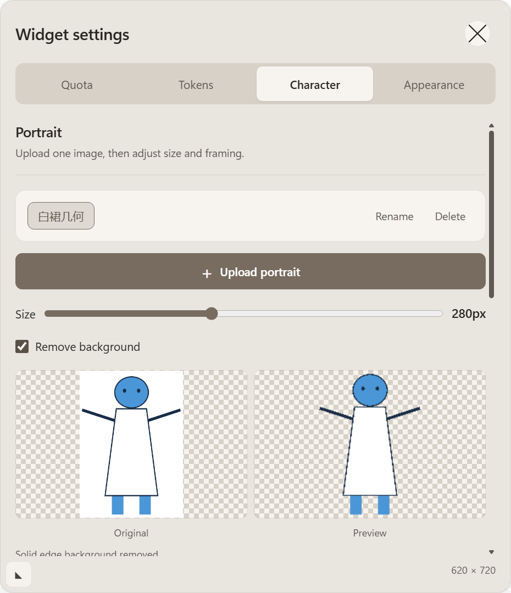
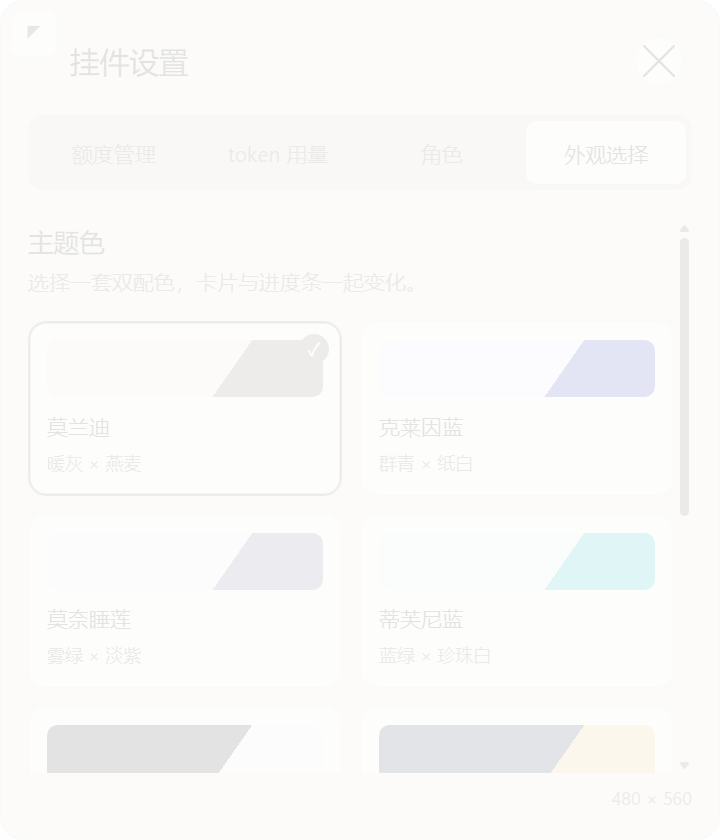
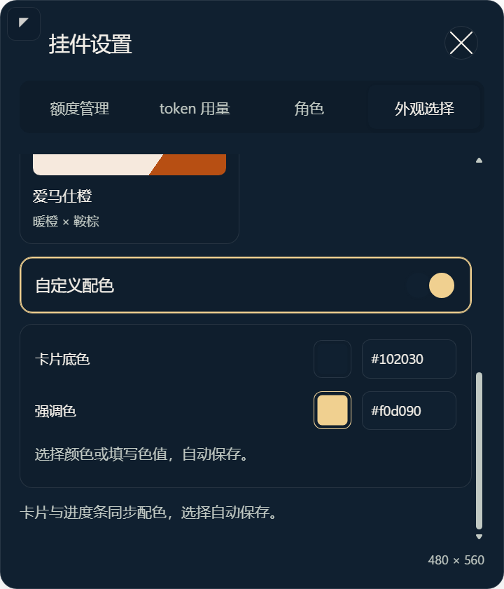
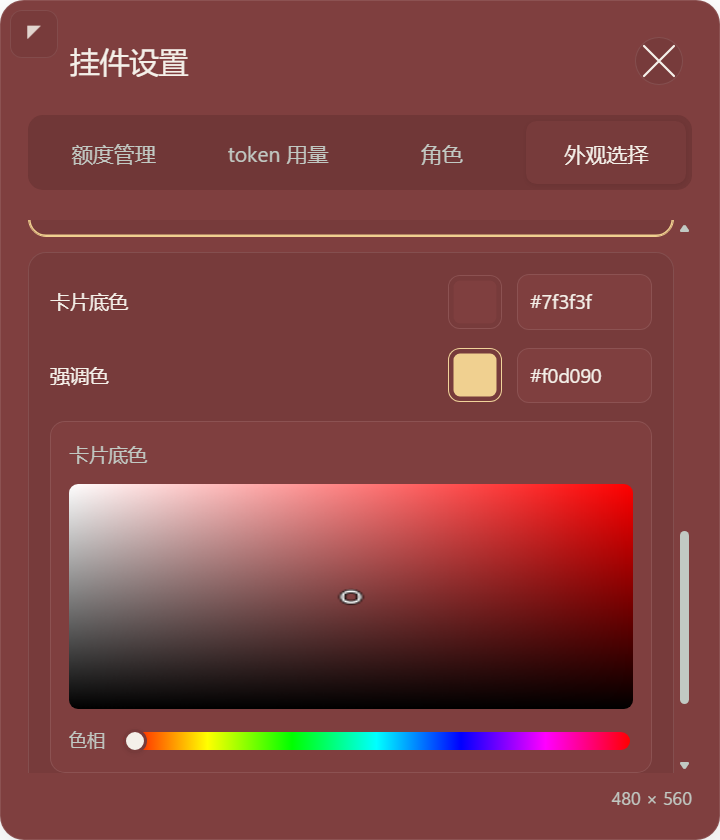
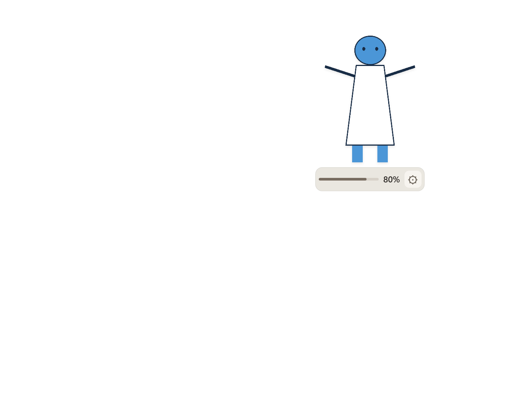

# 角色操作区、七组配色与完整立绘验收

基线：`c435ffc`。本轮只调整角色操作区、外观配色和绘制取景。`v1.0` 回退点及独立备份保持有效，未 push。

## 改动与原因

角色选择、更名、删除收进同一操作栏，上传入口独立排列；窄卡片自动换行，长角色名省略显示。立绘设置仍先于对话设置。

裁切来自原绘制公式：contain 比例再乘 zoom，随后直接加 x/y 位移；放大及偏移后的图片超出固定画布，底部进度条又压住人物。现场设置为 zoom=1.55、x≈-0.025、y≈0.756。用户明确要求保留上半身取景，因此最终保留 0.5–3 倍缩放：≤1 倍等比完整显示，平移使用剩余留白；>1 倍按缩放和平移计算源图取景范围，再绘制到立绘区域内。放大后的取景裁切是用户选择，进度条不会压住所选画面。原 settings.json 与原图片不会因启动而被改写。

移除常驻立绘的圆角遮罩。绘制区域保留最多 4 个画布像素内边距，底部留 52 DIP 给 42 DIP 高的进度条及间隙；立绘与进度条相隔 6 DIP。目标大小仍是整个挂件高度，280 对应立绘区域 228 DIP、420 对应 368 DIP。极宽图按既有布局可能只有 48 DIP 高，此时绘制区域最小 1 DIP，完整显示模式仍等比显示但很小；未扩大原生覆盖范围。

关闭按钮保留 44×44 DIP 点击区域，视觉底衬为 32 DIP 圆形、叉形笔画跨度 20 DIP，比例为 1.6，接近黄金比例。细圆角笔画、柔和底衬与标题对齐；关闭逻辑不变。

`desktop/geometry.cjs`、主进程、C# 焦点恢复、数据读取和网络白名单均未修改。窗口形状继续使用实际尺寸预算、全局上限与异常 1×1 回退；没有改成整个宿主可点击，也没有放开画布到 region 之外绘制。

## 七组灵感配色与自定义

没有统一的“世界最著名七种配色”官方榜单。本轮精选七组艺术/设计灵感，色值为适配界面可读性的本地设计，不声称是品牌官方数字色标准：

| 显示名称 | 双配色 | 灵感来源 |
| --- | --- | --- |
| 莫兰迪 | 暖灰 × 燕麦 | [古根海姆：Morandi 静物](https://www.guggenheim-bilbao.eus/sabias-que/morandi-naturaleza-muerta-natura-morta-1956) |
| 克莱因蓝 | 群青 × 纸白 | [Tate：IKB 79](https://www.tate.org.uk/art/artworks/klein-ikb-79-t01513) |
| 莫奈睡莲 | 雾绿 × 淡紫 | [英国国家美术馆：Water-lilies](https://www.nationalgallery.org.uk/paintings/claude-monet-water-lilies-1) |
| 蒂芙尼蓝 | 蓝绿 × 珍珠白 | [Tiffany：Tiffany Blue](https://press.tiffany.com/our-story/tiffany-blue/) |
| 黑白经典 | 墨黑 × 乳白 | [CHANEL 黑白服装](https://www.chanel.com/us/fashion/p/P81928V0291994305/midi-dress-silk-satin/) |
| 梵高星夜 | 夜蓝 × 星金 | [MoMA：The Starry Night](https://www.moma.org/collection/works/79802?locale=en) |
| 爱马仕橙 | 暖橙 × 鞍棕 | [Hermès：橙色盒子的故事](https://lanterne.hermes.com/en/special/special2412/) |

旧的六个 palette ID 仍接受，更新为上述新视觉，没有删除旧偏好文件。新增第七个橙色 ID 和 custom；自定义用设置页内的 HSV 取色面板或六位十六进制色值分别选择卡片底色、强调色，150ms 合并保存。原生 color 弹窗在恢复宿主焦点的环境中无法可靠点选，本轮移除它，点击色块直接展开页内色盘及色相滑杆，不创建新窗口。底色按原色保留，文字和强调色在必要时调整对比度并提示；自定义常驻底衬不透明，避免宿主背景破坏对比。色值输入复用现有的输入焦点例外，离开编辑后恢复普通点击的 80ms 方案。

## 已执行的验证

- 新增回归在修复前失败：不支持 custom、缺少完整绘制边界保护；修复后通过。
- `scripts/verify.ps1 -Native`：最终代码 102 个单元测试通过；实际 Electron 10 个异常形状用例回退 1×1 DIP（当前原生 2×2 像素）。新增 HSV 转换和上半身取景回归通过。
- `tests/Invoke-PortraitSmoke.ps1`：实际 Electron 白裙几何图，用 zoom=1.55 和偏移测试 180/280/420，drawImage 四边全部在画布内，底衬间隔均为 6 DIP；白裙中部像素仍为 `[255,255,255,255]`。大小持久化、切换恢复、极宽/窄图、滚轮及拖动时不重建额度卡片通过。
- `tests/Invoke-AppearanceSmoke.ps1`：七组配色、内部选中/焦点边框、色值键盘编辑、无效输入拒绝、保存及重新加载页面恢复通过。实际 Chromium mouseMove → mouseDown → mouseUp 在页内色盘选色，色相 0、中点得到约 #804040，验证保存后的 RGB 值；同一设置窗口中完成，窗口数量始终为 1。七组最低文字对比度 4.506283，主题切换 setShape 调用为 0、region 保持一致。
- 额外 2,430 组自定义颜色边界组合（深浅、灰色临界值和高饱和色）均可解析，所有返回的文字对比组合达到 4.5。
- `tests/Invoke-CardSmoke.ps1`：四页签、中文/英文、直接编辑对话、预设、两段气泡轮次、卡片缩放方向、小视口夹紧及关闭通过。
- `tests/Invoke-DragIoSmoke.ps1 -Baseline c435ffc`：单独运行每例 120 个拖动事件。视口内 22.26→19.48ms，边缘 17.14→17.67ms；前后 position/diagnostic 均为 0 次写入，松手后位置及诊断各一次。并行运行时曾观察到 32.43/24.06ms，故使用单独复测排除测试进程争用；未改变拖动热路径。

普通点击的真实 Windows 焦点恢复、形状外点击/滚动/选中及最小化恢复仍等待用户暂停鼠标后做现场探针，未用隐藏窗口替代或标为全部通过。本轮未启动 agent turn、增加额度请求或图片上传路径；图片原件及角色目录不变。

## 效果图

部署沿用已授权的 stop → 按源码清单逐文件更新缓存 → SHA256 → 缓存 start（标准插件重装此前因正在运行的 MCP 锁定缓存而拒绝访问）。最终部署文件数及现场状态见下方补记；这些状态不替代 300ms 焦点探针。

最终安装缓存与源码 **181/181** 个文件 SHA256 一致。部署前后真实用户角色目录 **3/3** 个文件哈希不变。缓存 `desktop/main.cjs` 启动的新 Electron PID 为 5056，`visible=true`、`focused=false`、`textEditing=false`。用户当前目标高度为 301，挂件 region 为 215×301，视口为 1707×1019；右下边界按现有 24 DIP 边距夹紧到 `{x:1468,y:694}` 并保存。未重置用户取景或图片。

均为本机几何占位素材和合成额度，无用户动漫素材：

