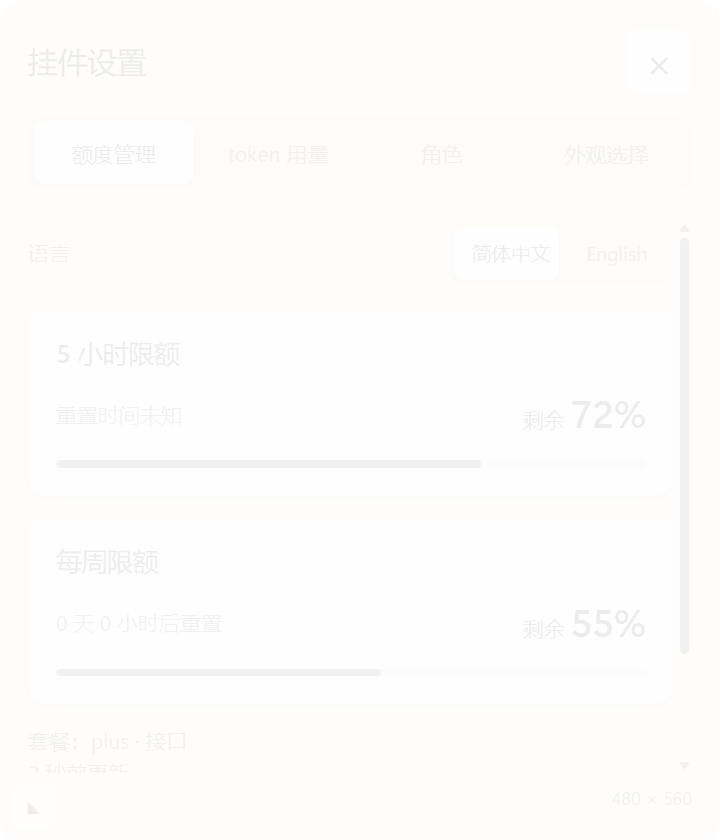
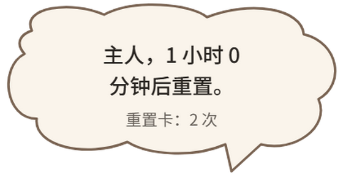
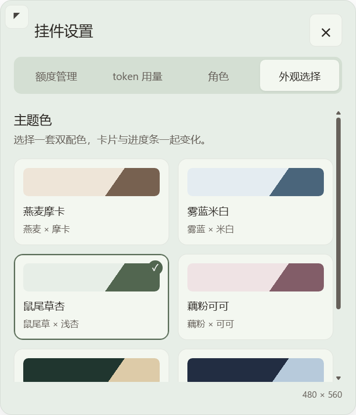
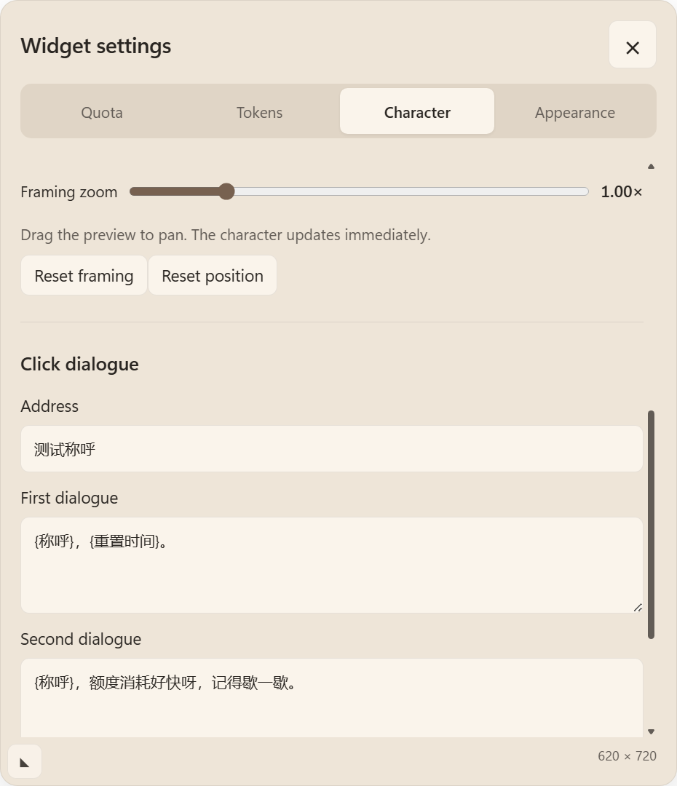

# 设置卡片与时间柱状图改造验收

## 1.0版本回退点

界面修改前工作区干净，已创建本地注释标签 `v1.0`（注释“1.0版本”），指向 `d5de6b83cd19afc7b81077f3243546e2fa1f25e6`。没有推送标签或代码。

独立备份：`C:\Users\Chester\.codex\codex-quota-widget\backups\1.0-20261010-223541`，包含 `source-1.0.zip`、完整安装缓存 `cache/` 和本机界面设置 `preferences/`。没有备份 auth.json、会话内容或把用户角色素材放入仓库。备份位置另记于运行目录的 `version-1.0-backup-path.txt`。

回退顺序：停止挂件；先保留本轮代码和用户新改设置；在干净工作区切换到 `v1.0`（或解压源码归档到独立目录）；恢复该版本安装缓存并核对哈希；从缓存启动。仅需回退界面时保留最新角色素材及用户设置；如需恢复设置，可从上述 preferences 按文件恢复。`1.0版本` 是用户指定的回退标签，插件清单及 MCP 的 `0.1.0` 缓存路径没有变更。

## 改动及证据

视觉参考：[Radix Card](https://www.radix-ui.com/themes/docs/components/card)、[Shadcn Admin](https://github.com/satnaing/shadcn-admin)、[Tremor Bar Chart](https://www.tremor.so/docs/visualizations/bar-chart)。采用薄边框、轻阴影、分组标题和分隔线、时间轴柱形图；沿用本机 HTML/CSS/SVG，没有引入 React、远程脚本、字体下载或图片上传路径。

| 项目 | 本轮结果与证据 |
| --- | --- |
| 语言切换 | 原生 select 依赖保持窗口焦点，与 80ms 焦点恢复的交互存在冲突；改为直接点击中文 / English 按钮。真实 Electron 鼠标事件验证切为英文，额度标题、四页签和角色/外观标签更新，重启后语言仍为英文。用户自定义对话与角色名称保持原文。 |
| 卡片距离 | 不再冻结缩放前的像素偏移，沿用 geometry.layout 的紧邻立绘布局和视口夹紧。回归复现旧版缩小后间距 132 DIP；修复后为 12 DIP。geometry.cjs 的矩形、面积及全局上限校验未修改。 |
| 缩放方向 | 把手位于远离立绘的外侧角，横纵方向由实际展开位置确定。向外变大、向内变小；鼠标和箭头键使用同一方向。左侧卡片向左 140 / 向下 160，480×560 → 620×720；真实 Electron 断言把手中心跟随指针（误差 <2 DIP）。拖动结束保存，重启保留 640×720，临时小视口夹紧不覆盖保存的尺寸。 |
| 角色页顺序 | 立绘设置（上传、大小、去底、预览、取景、重置位置）在前，对话设置在后，DOM 次序及滚轮通过真实 Electron 验证。 |
| 对话直接编辑 | 设置页的称呼与两段文本可直接编辑，保存/取消在同一页完成。主进程及 preload 已移除独立编辑窗口的调用入口。真实 Electron 插入文字、保存到独立偏好文件、取消草稿恢复，以及窗口总数为 1 的断言通过。旧版原生编辑器文件仅作历史兼容保留，不再被加载。 |
| 编辑时的焦点 | 用户主动点击文本输入框时，当前窗口设置固定的 `[Text editing]` 标记并接收键盘/IME；离开输入框、保存、取消、关闭或点击立绘时清除。C# 只对经过既有 PID/HWND/owner 检查的挂件窗口临时跳过恢复；清除标记的窗口名称事件仍走原有 80ms 恢复。普通立绘点击未放宽焦点门槛。实机输入与恢复待本轮探针。 |
| 外观选中框 | 旧 outline 画在按钮外，被滚动区裁剪；改为内部 border + inset shadow，键盘焦点圈也放在内部。六套配色通过，最低文字对比度 4.507；主题切换引起 shape 调用为 0。 |
| 字体 | 设置页中文改用本机微软雅黑 UI，英文 Segoe UI Variable Text；未下载或分发 Apple 专用字体。标题/强调 500，正文 400。额度卡片把“剩余”标签（14px / 400）与百分比（26px / Segoe UI Variable Display / 500）分开排版；常驻百分比沿用同一数字字体。字体观感待用户确认。 |
| 保存与取消 | 两个对话操作按钮统一为卡片表面色和主文字色，六套配色下的实际 computedStyle 颜色一致；保存、取消编辑的行为保持。 |
| token 图 | 选择 24 小时 / 7 天 / 30 天，分别显示 24 / 7 / 30 根纵向柱形、时间轴、所选总数和悬停精确时间/数量，另有可选中复制的精确列表。没有用聚合总数伪造历史分布。 |
| 气泡及设置入口 | 用户选择预览 C，使用同一个本地 SVG 云朵轮廓（2px 描边）和思源黑体 Medium（Noto Sans SC / 500 / 17px）。背景及描边跟随当前外观变量，纯装饰 SVG 不接收鼠标、不读网络。均衡换行减少孤字，长对话可在正文区滚动。第一段显示重置信息；仅气泡仍可见时点击立绘进入第二段提醒；第二段隐藏重置信息；关闭后重新从第一段开始。280×152 气泡区域保持，geometry.cjs 未改。齿轮打开设置、外部信号关闭、44×44 关闭按钮保留。真实 Electron 验证云朵节点、字体和第二段隐藏信息均通过。 |

## token 时间口径

直接复用本机增量索引的 `{at,value}`，原始 JSONL 内容不进入视图。小时图显示当前小时及之前 23 小时；日图显示今天及之前 6 / 29 个本机自然日期。当前小时和当天尚未结束，图内已说明。总数等于当前所有柱形之和；旧 `values` 的滚动 24h/7d/30d 聚合保留供既有诊断兼容，图中使用 `series.total`，避免两个口径混用。

空时段补 0；未来记录排除；边界记录仅分配一次。夏令时日按本机日期递增，因此可为 23 或 25 小时；小时回拨的两个同名小时保留不同时间戳，悬停附时区。单位测试覆盖 30 日跨回拨和重复小时分离。5 分钟缓存命中保持同一个统计截止点，实机缓存命中 `bytesReadThisCycle=0`，没有额外会话读取。

## 自动回归

- `scripts/verify.ps1 -Native`：95 个单元测试通过；真实 Electron 异常 shape 10 案例回退 1×1 DIP（当前原生 2×2 像素）。
- `Invoke-CardSmoke.ps1`：鼠标切换语言、缩放方向及跟随、直接编辑保存/取消、四页签、滚轮、气泡轮次、关闭、小视口夹紧通过；`-Restart` 验证语言、尺寸、对话偏好保存。
- `Invoke-PopupSmoke.ps1`：24 / 7 / 30 根柱形，柱形与所选总数一致，三种小视口无横向溢出。
- `Invoke-AppearanceSmoke.ps1`：六主题、内部选择/焦点边框、对比度、形状不变通过。
- `Invoke-DragIoSmoke.ps1 -Baseline d5de6b8`：每例 120 个 drag 事件，前后均 position=0、diagnostic=0 次写入。视口内耗时 22.10 → 19.79ms；边缘 19.30 → 18.84ms；松手后位置及诊断各落盘一次。此次 C# 输入标记不增加拖动写盘或逐键写盘。

普通点击 300ms 内恢复宿主、形状外穿透、拖动保存及最小化恢复：等待本轮用户暂停鼠标后进行实机验证，不以隐藏窗口测试代替。

额度请求、只读授权白名单、会话索引扫描流程、用户图片导入/迁移与源文件、默认位置及 snap 均保留。未使用 codex exec / review 或增加 agent turn / 图片上传路径。CLI `0.162.0-alpha.17.2`、系统 DPI96 / 窗口144 的既有待观察项保留。

## 安装与效果

标准 `codex plugin add codex-quota-widget@personal --json` 返回 Windows `failed to back up plugin cache entry / 拒绝访问 (os error 5)`。沿用已授权的 stop → 按源码清单逐文件更新缓存 → SHA256 → 缓存 start；没有终止 Codex 的 MCP 进程。最终源码清单 172/172 文件 SHA256 一致，明细存于运行目录 `radix-redesign-cache-hashes.json`。云朵版已在缓存运行。实机探针仍等待用户暂停鼠标，未标记全部验收通过。

效果图仅使用独立几何占位素材和合成额度/token 数据，不含用户立绘或会话内容：

